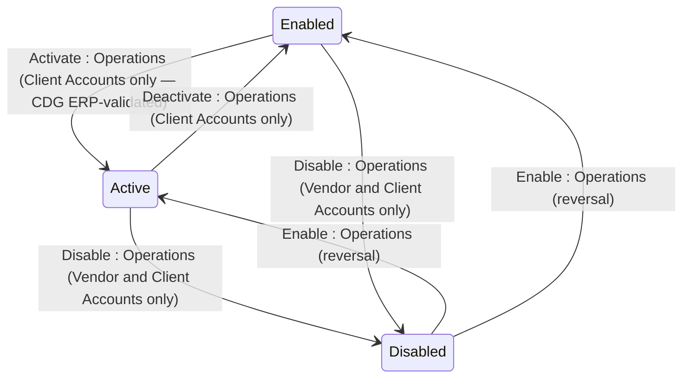

## State diagram

## States

<table>
  <thead>
    <tr>
      <th>State</th>
      <th>Description</th>
      <th>Initial State?</th>
      <th>Terminal State?</th>
    </tr>
  </thead>
  <tbody>
    <tr>
      <td>Active</td>
      <td>Applies to Vendor and Client Accounts. On Client Accounts, `Active` means the `externalId` (CDG) is present and has been validated against SoftwareOne&#39;s ERP — the Account can transact and be billed. On Vendor Accounts, `Active` is the default creation state; no ERP validation is required or performed.</td>
      <td>—</td>
      <td>—</td>
    </tr>
    <tr>
      <td>Enabled</td>
      <td>Applies to Client and Operations Accounts. On Client Accounts, `Enabled` means the Account is not Disabled but the CDG has not been ERP-validated — the Account cannot transact or be billed. On the Operations Account, `Enabled` is the default creation state; ERP validation is not applicable.</td>
      <td>—</td>
      <td>—</td>
    </tr>
    <tr>
      <td>Disabled</td>
      <td>Applies to Vendor and Client Accounts. The Account is inactive. The Operations Account cannot be set to `Disabled`. While Disabled, the Account cannot place new Orders or participate in Programs. Existing Users and API Tokens are unaffected — see BR-015.</td>
      <td>—</td>
      <td>—</td>
    </tr>
  </tbody>
</table>

## Transitions

<table>
  <thead>
    <tr>
      <th>ID</th>
      <th>From State</th>
      <th>To State</th>
      <th>Action</th>
      <th>Endpoint / Verb</th>
      <th>Actor</th>
      <th>Precondition</th>
      <th>Notes</th>
    </tr>
  </thead>
  <tbody>
    <tr>
      <td>T1a</td>
      <td>—</td>
      <td>Active</td>
      <td>Create</td>
      <td>`POST /v1/accounts/accounts`</td>
      <td>Operations</td>
      <td>None</td>
      <td>Vendor Accounts are created directly into `Active` status. No ERP validation required.</td>
    </tr>
    <tr>
      <td>T1b</td>
      <td>—</td>
      <td>Enabled</td>
      <td>Create</td>
      <td>`POST /v1/accounts/accounts`</td>
      <td>Operations</td>
      <td>None</td>
      <td>Client and Operations Accounts are created directly into `Enabled` status.</td>
    </tr>
    <tr>
      <td>T2</td>
      <td>Enabled</td>
      <td>Active</td>
      <td>Activate Account</td>
      <td>`POST /v1/accounts/accounts/{id}/activate`</td>
      <td>Operations</td>
      <td>CDG present in `externalId` and validated against ERP</td>
      <td>Client Accounts only — the platform rejects this action outright on Vendor or Operations Accounts.</td>
    </tr>
    <tr>
      <td>T3a</td>
      <td>Active</td>
      <td>Disabled</td>
      <td>Disable Account</td>
      <td>`POST /v1/accounts/accounts/{id}/disable`</td>
      <td>Operations</td>
      <td>Not confirmed</td>
      <td>Applies to Vendor and Client Accounts only.</td>
    </tr>
    <tr>
      <td>T3b</td>
      <td>Enabled</td>
      <td>Disabled</td>
      <td>Disable Account</td>
      <td>`POST /v1/accounts/accounts/{id}/disable`</td>
      <td>Operations</td>
      <td>Not confirmed</td>
      <td>Applies to Vendor and Client Accounts only.</td>
    </tr>
    <tr>
      <td>T4a</td>
      <td>Disabled</td>
      <td>Active</td>
      <td>Enable Account</td>
      <td>`POST /v1/accounts/accounts/{id}/enable`</td>
      <td>Operations</td>
      <td>Not confirmed</td>
      <td>Reversal of T3a.</td>
    </tr>
    <tr>
      <td>T4b</td>
      <td>Disabled</td>
      <td>Enabled</td>
      <td>Enable Account</td>
      <td>`POST /v1/accounts/accounts/{id}/enable`</td>
      <td>Operations</td>
      <td>Not confirmed</td>
      <td>Reversal of T3b.</td>
    </tr>
    <tr>
      <td>T5</td>
      <td>Active</td>
      <td>Enabled</td>
      <td>Deactivate Account</td>
      <td>`POST /v1/accounts/accounts/{id}/deactivate`</td>
      <td>Operations</td>
      <td>None confirmed</td>
      <td>Client Accounts only — the platform rejects this action outright on Vendor or Operations Accounts. Previously undocumented.</td>
    </tr>
  </tbody>
</table>

