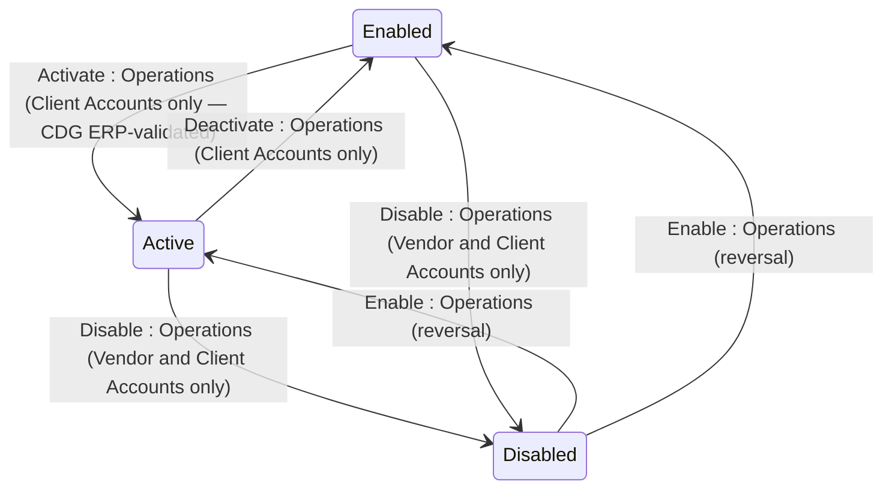

## State diagram

| State | Description | Initial State? | Terminal State? |
| --- | --- | --- | --- |

| Active | Applies to Vendor and Client Accounts. On Client Accounts, `Active` means the `externalId` (CDG) is present and has been validated against SoftwareOne's ERP — the Account can transact and be billed. On Vendor Accounts, `Active` is the default creation state; no ERP validation is required or performed. | — | — |

| Enabled | Applies to Client and Operations Accounts. On Client Accounts, `Enabled` means the Account is not Disabled but the CDG has not been ERP-validated — the Account cannot transact or be billed. On the Operations Account, `Enabled` is the default creation state; ERP validation is not applicable. | — | — |

| Disabled | Applies to Vendor and Client Accounts. The Account is inactive. The Operations Account cannot be set to `Disabled`. While Disabled, the Account cannot place new Orders or participate in Programs. Existing Users and API Tokens are unaffected — see BR-015. | — | — |

