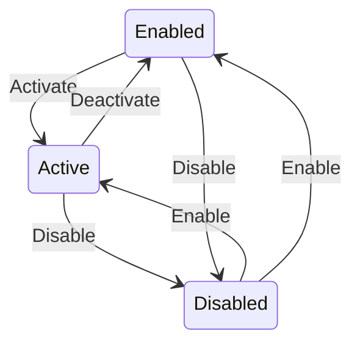

The Marketplace Platform provides three distinct user interfaces, namely the Client Portal, Vendor Portal, and Operations Portal. This topic describes how the account object transitions through different lifecycle states within the platform.


The diagrams show different transitions depending on whether the account is a Client/Partner or a Vendor, but the underlying statuses are the same.


## Diagram

## States

<table>
  <thead>
    <tr>
      <th>State</th>
      <th>Description</th>
      <th>Initial State?</th>
      <th>Terminal State?</th>
    </tr>
  </thead>
  <tbody>
    <tr>
      <td>Active</td>
      <td>Applies to Vendor and Client Accounts. On Client Accounts, `Active` means the `externalId` (CDG) is present and has been validated against SoftwareOne&#39;s ERP — the Account can transact and be billed. On Vendor Accounts, `Active` is the default creation state; no ERP validation is required or performed.</td>
      <td>—</td>
      <td>—</td>
    </tr>
    <tr>
      <td>Enabled</td>
      <td>Applies to Client and Operations Accounts. On Client Accounts, `Enabled` means the Account is not Disabled but the CDG has not been ERP-validated — the Account cannot transact or be billed. On the Operations Account, `Enabled` is the default creation state; ERP validation is not applicable.</td>
      <td>—</td>
      <td>—</td>
    </tr>
    <tr>
      <td>Disabled</td>
      <td>Applies to Vendor and Client Accounts. The Account is inactive. The Operations Account cannot be set to `Disabled`. While Disabled, the Account cannot place new Orders or participate in Programs. Existing Users and API Tokens are unaffected — see BR-015.</td>
      <td>—</td>
      <td>—</td>
    </tr>
  </tbody>
</table>

## Transitions

<table>
  <thead>
    <tr>
      <th>From State</th>
      <th>To State</th>
      <th>Action</th>
      <th>Endpoint / Verb</th>
      <th>Actor</th>
    </tr>
  </thead>
  <tbody>
    <tr>
      <td>—</td>
      <td>Active</td>
      <td>Create</td>
      <td>`POST /v1/accounts/accounts`</td>
      <td>Operations</td>
    </tr>
    <tr>
      <td>—</td>
      <td>Enabled</td>
      <td>Create</td>
      <td>`POST /v1/accounts/accounts`</td>
      <td>Operations</td>
    </tr>
    <tr>
      <td>Enabled</td>
      <td>Active</td>
      <td>Activate Account</td>
      <td>`POST /v1/accounts/accounts/{id}/activate`</td>
      <td>Operations</td>
    </tr>
    <tr>
      <td>Active</td>
      <td>Disabled</td>
      <td>Disable Account</td>
      <td>`POST /v1/accounts/accounts/{id}/disable`</td>
      <td>Operations</td>
    </tr>
    <tr>
      <td>Enabled</td>
      <td>Disabled</td>
      <td>Disable Account</td>
      <td>`POST /v1/accounts/accounts/{id}/disable`</td>
      <td>Operations</td>
    </tr>
    <tr>
      <td>Disabled</td>
      <td>Active</td>
      <td>Enable Account</td>
      <td>`POST /v1/accounts/accounts/{id}/enable`</td>
      <td>Operations</td>
    </tr>
    <tr>
      <td>Disabled</td>
      <td>Enabled</td>
      <td>Enable Account</td>
      <td>`POST /v1/accounts/accounts/{id}/enable`</td>
      <td>Operations</td>
    </tr>
    <tr>
      <td>Active</td>
      <td>Enabled</td>
      <td>Deactivate Account</td>
      <td>`POST /v1/accounts/accounts/{id}/deactivate`</td>
      <td>Operations</td>
    </tr>
  </tbody>
</table>

