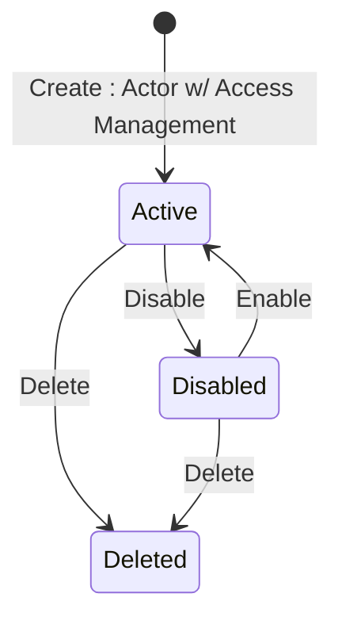

## Diagram

## States

<table>
  <thead>
    <tr>
      <th>State</th>
      <th>Description</th>
      <th>Initial State?</th>
      <th>Terminal State?</th>
    </tr>
  </thead>
  <tbody>
    <tr>
      <td>Active</td>
      <td>The token can authenticate to the platform and exercise its permission set. This is the state every token is created in.</td>
      <td>Yes</td>
      <td>No</td>
    </tr>
    <tr>
      <td>Disabled</td>
      <td>The token is administratively suspended. It is retained with all its configuration but can no longer authenticate. Reached via Disable; left via Enable.</td>
      <td>No</td>
      <td>No</td>
    </tr>
    <tr>
      <td>Deleted</td>
      <td>The token has been deleted — a soft-delete: its status is set to `Deleted` and the record is retained, but it can no longer authenticate. It remains retrievable by Operations (holding Platform Account Management) but is removed from Vendor and Client API visibility. Reached from `Active` or `Disabled`; no transition out.</td>
      <td>No</td>
      <td>Yes</td>
    </tr>
  </tbody>
</table>

## Transitions

<table>
  <thead>
    <tr>
      <th>ID</th>
      <th>To State</th>
      <th>Endpoint / Verb</th>
    </tr>
  </thead>
  <tbody>
    <tr>
      <td>T1</td>
      <td>Active</td>
      <td>`POST` (base collection endpoint)</td>
    </tr>
    <tr>
      <td>T2</td>
      <td>Disabled</td>
      <td>`disable`</td>
    </tr>
    <tr>
      <td>T3</td>
      <td>Active</td>
      <td>`enable`</td>
    </tr>
    <tr>
      <td>T4</td>
      <td>Deleted</td>
      <td>`DELETE` (`/{id}`, returns 204)</td>
    </tr>
    <tr>
      <td>T5</td>
      <td>Deleted</td>
      <td>`DELETE` (`/{id}`, returns 204)</td>
    </tr>
  </tbody>
</table>

