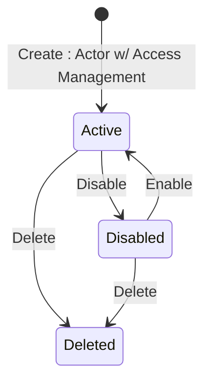

The Marketplace Platform provides three distinct user interfaces, namely the Client Portal, Vendor Portal, and Operations Portal. This topic describes how the account object transitions through different lifecycle states within the platform.


The diagrams show different transitions depending on whether the account is a Client/Partner or a Vendor, but the underlying statuses are the same.


## Diagram

## States

<table>
  <thead>
    <tr>
      <th>State</th>
      <th>Description</th>
      <th>Initial State?</th>
      <th>Terminal State?</th>
    </tr>
  </thead>
  <tbody>
    <tr>
      <td>Active</td>
      <td>The token can authenticate to the platform and exercise its permission set. This is the state every token is created in.</td>
      <td>Yes</td>
      <td>No</td>
    </tr>
    <tr>
      <td>Disabled</td>
      <td>The token is administratively suspended. It is retained with all its configuration but can no longer authenticate. Reached via Disable; left via Enable.</td>
      <td>No</td>
      <td>No</td>
    </tr>
    <tr>
      <td>Deleted</td>
      <td>The token has been deleted — a soft-delete: its status is set to `Deleted` and the record is retained, but it can no longer authenticate. It remains retrievable by Operations (holding Platform Account Management) but is removed from Vendor and Client API visibility. Reached from `Active` or `Disabled`; no transition out.</td>
      <td>No</td>
      <td>Yes</td>
    </tr>
  </tbody>
</table>

## Transitions

<table>
  <thead>
    <tr>
      <th>From State</th>
      <th>To State</th>
      <th>Action</th>
      <th>Endpoint / Verb</th>
      <th>Actor</th>
    </tr>
  </thead>
  <tbody>
    <tr>
      <td>—</td>
      <td>Active</td>
      <td>Create</td>
      <td>`POST` (base collection endpoint)</td>
      <td>Actor with Access Management permission in the target Account</td>
    </tr>
    <tr>
      <td>Active</td>
      <td>Disabled</td>
      <td>Disable</td>
      <td>`disable`</td>
      <td>Actor with the applicable administration permission (BR-004)</td>
    </tr>
    <tr>
      <td>Disabled</td>
      <td>Active</td>
      <td>Enable</td>
      <td>`enable`</td>
      <td>Actor with the applicable administration permission (BR-004)</td>
    </tr>
    <tr>
      <td>Active</td>
      <td>Deleted</td>
      <td>Delete</td>
      <td>`DELETE` (`/{id}`, returns 204)</td>
      <td>Actor with the applicable administration permission (BR-004)</td>
    </tr>
    <tr>
      <td>Disabled</td>
      <td>Deleted</td>
      <td>Delete</td>
      <td>`DELETE` (`/{id}`, returns 204)</td>
      <td>Actor with the applicable administration permission (BR-004)</td>
    </tr>
  </tbody>
</table>

