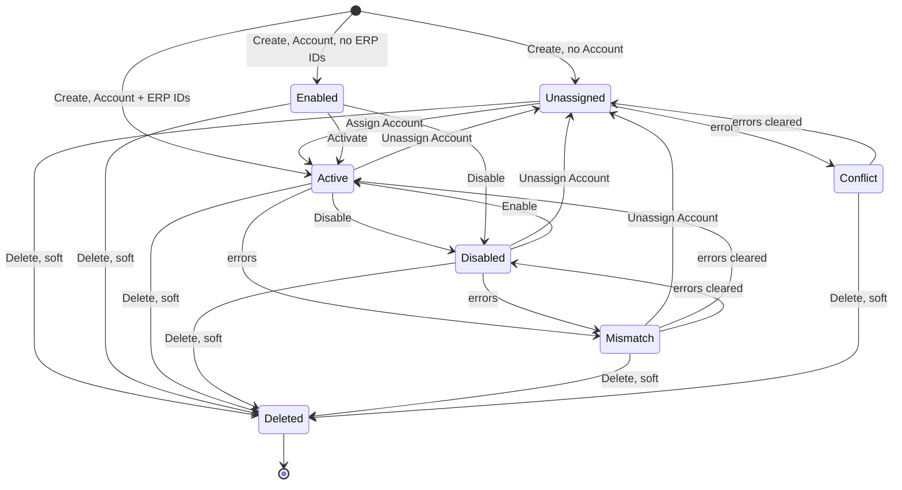

## Diagram

## States

<table>
  <thead>
    <tr>
      <th>State</th>
      <th>Description</th>
      <th>Initial State?</th>
      <th>Terminal State?</th>
    </tr>
  </thead>
  <tbody>
    <tr>
      <td>Unassigned</td>
      <td>The Buyer is not linked to any [[Account]].</td>
      <td>Yes (when created without an Account)</td>
      <td>No</td>
    </tr>
    <tr>
      <td>Enabled</td>
      <td>The Buyer is linked to an [[Account]] but has no ERP identifiers of its own yet — it is not ERP-activated and cannot be synchronised with the ERP.</td>
      <td>Yes (when created with an Account but no ERP IDs)</td>
      <td>No</td>
    </tr>
    <tr>
      <td>Active</td>
      <td>The Buyer is linked to an [[Account]] and carries its ERP identifiers — fully reconciled and operational.</td>
      <td>Yes (when created with an Account and ERP IDs)</td>
      <td>No</td>
    </tr>
    <tr>
      <td>Disabled</td>
      <td>The Buyer has been manually disabled from Active or Enabled.</td>
      <td>No</td>
      <td>No</td>
    </tr>
    <tr>
      <td>Deleted</td>
      <td>The Buyer has been soft-deleted. Remains retrievable to Operations; excluded from Vendor/Client row-scoped queries.</td>
      <td>No</td>
      <td>Yes</td>
    </tr>
    <tr>
      <td>Conflict</td>
      <td>Overlay state: an Unassigned Buyer that also has reconciliation errors. Returns to Unassigned when the errors clear.</td>
      <td>No</td>
      <td>No</td>
    </tr>
    <tr>
      <td>Mismatch</td>
      <td>Overlay state: an Active or Disabled Buyer that also has reconciliation errors. Returns to its pre-error status when the errors clear.</td>
      <td>No</td>
      <td>No</td>
    </tr>
  </tbody>
</table>

## Transitions

<table>
  <thead>
    <tr>
      <th>From State</th>
      <th>To State</th>
      <th>Action</th>
      <th>Endpoint / Verb</th>
      <th>Actor</th>
    </tr>
  </thead>
  <tbody>
    <tr>
      <td>—</td>
      <td>Unassigned</td>
      <td>Create Buyer</td>
      <td>`POST /v1/accounts/buyers`</td>
      <td>Operations</td>
    </tr>
    <tr>
      <td>—</td>
      <td>Enabled</td>
      <td>Create Buyer</td>
      <td>`POST /v1/accounts/buyers`</td>
      <td>Operations</td>
    </tr>
    <tr>
      <td>—</td>
      <td>Active</td>
      <td>Create Buyer</td>
      <td>`POST /v1/accounts/buyers`</td>
      <td>Operations</td>
    </tr>
    <tr>
      <td>Active</td>
      <td>Disabled</td>
      <td>Disable Buyer</td>
      <td>`POST /v1/accounts/buyers/{id}/disable`</td>
      <td>Operations, Client (own Account)</td>
    </tr>
    <tr>
      <td>Enabled</td>
      <td>Disabled</td>
      <td>Disable Buyer</td>
      <td>`POST /v1/accounts/buyers/{id}/disable`</td>
      <td>Operations, Client (own Account)</td>
    </tr>
    <tr>
      <td>Disabled</td>
      <td>Active</td>
      <td>Enable Buyer</td>
      <td>`POST /v1/accounts/buyers/{id}/enable`</td>
      <td>Operations, Client (own Account)</td>
    </tr>
    <tr>
      <td>Enabled</td>
      <td>Active</td>
      <td>Activate Buyer</td>
      <td>`POST /v1/accounts/buyers/{id}/activate`</td>
      <td>Operations</td>
    </tr>
    <tr>
      <td>Unassigned</td>
      <td>Active</td>
      <td>Assign Account</td>
      <td>`PUT /v1/accounts/buyers/{id}` (Account added)</td>
      <td>Operations</td>
    </tr>
    <tr>
      <td>Active</td>
      <td>Unassigned</td>
      <td>Unassign Account</td>
      <td>`PUT /v1/accounts/buyers/{id}` (Account removed)</td>
      <td>Operations</td>
    </tr>
    <tr>
      <td>Active</td>
      <td>Deleted</td>
      <td>Delete Buyer</td>
      <td>`DELETE /v1/accounts/buyers/{id}`</td>
      <td>Operations</td>
    </tr>
  </tbody>
</table>

