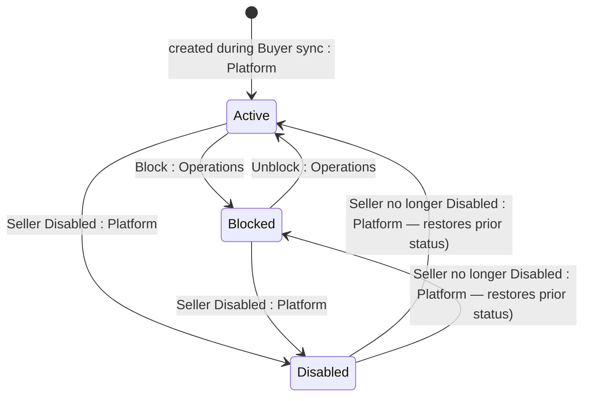

## State diagram

## States

<table>
  <thead>
    <tr>
      <th>State</th>
      <th>Description</th>
      <th>Initial State?</th>
      <th>Terminal State?</th>
    </tr>
  </thead>
  <tbody>
    <tr>
      <td>Active</td>
      <td>The link is operational.</td>
      <td>Yes</td>
      <td>No</td>
    </tr>
    <tr>
      <td>Blocked</td>
      <td>The link has been blocked — in practice because the customer is blocked in the ERP. Set via the Block action; reversible via Unblock.</td>
      <td>No</td>
      <td>No</td>
    </tr>
    <tr>
      <td>Disabled</td>
      <td>System-controlled: set automatically when the linked [[Seller]] is Disabled, and reversed when the Seller is no longer Disabled. Cannot be changed by user actions while in this state.</td>
      <td>No</td>
      <td>No</td>
    </tr>
  </tbody>
</table>

## Transitions

<table>
  <thead>
    <tr>
      <th>ID</th>
      <th>From State</th>
      <th>To State</th>
      <th>Action</th>
      <th>Endpoint / Verb</th>
      <th>Actor</th>
      <th>Precondition</th>
      <th>Notes</th>
    </tr>
  </thead>
  <tbody>
    <tr>
      <td>T1</td>
      <td>—</td>
      <td>Active</td>
      <td>Create (ERP-sync reconciliation)</td>
      <td>(no endpoint — created during [[Buyer]] synchronisation)</td>
      <td>Platform</td>
      <td>—</td>
      <td>ErpLinks are minted by the platform when a Buyer&#39;s Seller set is reconciled. Cannot be created Blocked.</td>
    </tr>
    <tr>
      <td>T2</td>
      <td>Active</td>
      <td>Blocked</td>
      <td>Block link</td>
      <td>`POST /v1/accounts/erp-links/{id}/block`</td>
      <td>Operations</td>
      <td>Link not Disabled; [[Buyer]] is ERP-activated; no Accounts: Licensee in Active or Enabled status on the (Buyer, Seller) pair; linked [[Seller]] not Disabled or Deleted</td>
      <td>See BR-005. In practice driven by the ERP-sync integration reflecting an ERP-side customer block.</td>
    </tr>
    <tr>
      <td>T3</td>
      <td>Blocked</td>
      <td>Active</td>
      <td>Unblock link</td>
      <td>`POST /v1/accounts/erp-links/{id}/unblock`</td>
      <td>Operations</td>
      <td>Link not Disabled; [[Buyer]] is ERP-activated</td>
      <td>—</td>
    </tr>
    <tr>
      <td>T4a</td>
      <td>Active</td>
      <td>Disabled</td>
      <td>Disable link (Seller Disabled)</td>
      <td>(no endpoint — system, at [[Buyer]] synchronisation)</td>
      <td>Platform</td>
      <td>Linked [[Seller]] became Disabled</td>
      <td>Records the prior status for later restore.</td>
    </tr>
    <tr>
      <td>T4b</td>
      <td>Blocked</td>
      <td>Disabled</td>
      <td>Disable link (Seller Disabled)</td>
      <td>(no endpoint — system, at [[Buyer]] synchronisation)</td>
      <td>Platform</td>
      <td>Linked [[Seller]] became Disabled</td>
      <td>Records the prior status for later restore.</td>
    </tr>
    <tr>
      <td>T5a</td>
      <td>Disabled</td>
      <td>Active</td>
      <td>Enable link (Seller no longer Disabled)</td>
      <td>(no endpoint — system, at [[Buyer]] synchronisation)</td>
      <td>Platform</td>
      <td>Linked [[Seller]] no longer Disabled; prior status was Active</td>
      <td>Restores the status held before Disable.</td>
    </tr>
    <tr>
      <td>T5b</td>
      <td>Disabled</td>
      <td>Blocked</td>
      <td>Enable link (Seller no longer Disabled)</td>
      <td>(no endpoint — system, at [[Buyer]] synchronisation)</td>
      <td>Platform</td>
      <td>Linked [[Seller]] no longer Disabled; prior status was Blocked</td>
      <td>Restores the status held before Disable.</td>
    </tr>
  </tbody>
</table>

