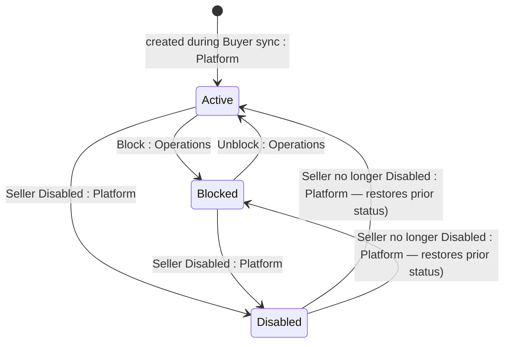

## State diagram

| State | Description | Initial State? | Terminal State? |
| --- | --- | --- | --- |

| Active | The link is operational. | Yes | No |

| Blocked | The link has been blocked — in practice because the customer is blocked in the ERP. Set via the Block action; reversible via Unblock. | No | No |

| Disabled | System-controlled: set automatically when the linked [[Seller]] is Disabled, and reversed when the Seller is no longer Disabled. Cannot be changed by user actions while in this state. | No | No |

