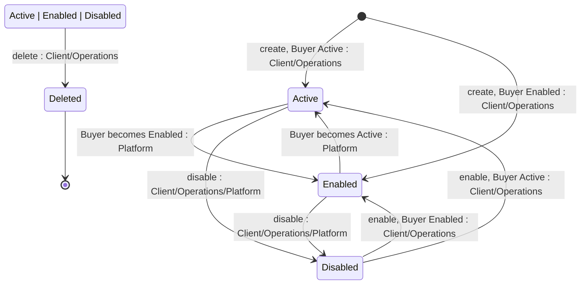

## Diagram

## States

<table>
  <thead>
    <tr>
      <th>State</th>
      <th>Description</th>
      <th>Initial State?</th>
      <th>Terminal State?</th>
    </tr>
  </thead>
  <tbody>
    <tr>
      <td>Active</td>
      <td>The Licensee is linked to an Active Buyer — one correctly linked to an ERP customer record. Only an Active Licensee may be used to place new Orders.</td>
      <td>Yes*</td>
      <td>No</td>
    </tr>
    <tr>
      <td>Enabled</td>
      <td>The Licensee is linked to an Enabled Buyer — one enabled without ERP activation. It cannot be used to place new Orders.</td>
      <td>Yes*</td>
      <td>No</td>
    </tr>
    <tr>
      <td>Disabled</td>
      <td>Set explicitly by a Client or Operations action, or automatically when the related Buyer or Seller is disabled. Cannot be used for new Orders, but remains usable for change and termination Orders against existing Agreements. Retained for historical reference.</td>
      <td>No</td>
      <td>No</td>
    </tr>
    <tr>
      <td>Deleted</td>
      <td>Soft-deleted. The record is retained but no longer usable, and is visible only to Operations.</td>
      <td>No</td>
      <td>Yes</td>
    </tr>
  </tbody>
</table>

## Transitions

<table>
  <thead>
    <tr>
      <th>ID</th>
      <th>To State</th>
      <th>Endpoint / Verb</th>
    </tr>
  </thead>
  <tbody>
    <tr>
      <td>T1a</td>
      <td>Active</td>
      <td>`POST /v1/accounts/licensees`</td>
    </tr>
    <tr>
      <td>T1b</td>
      <td>Enabled</td>
      <td>`POST /v1/accounts/licensees`</td>
    </tr>
    <tr>
      <td>T2</td>
      <td>Active</td>
      <td>(no endpoint — propagated at Buyer synchronisation)</td>
    </tr>
    <tr>
      <td>T3</td>
      <td>Enabled</td>
      <td>(no endpoint — propagated at Buyer synchronisation)</td>
    </tr>
    <tr>
      <td>T4a</td>
      <td>Disabled</td>
      <td>`POST /v1/accounts/licensees/{id}/disable`</td>
    </tr>
    <tr>
      <td>T4b</td>
      <td>Disabled</td>
      <td>`POST /v1/accounts/licensees/{id}/disable`</td>
    </tr>
    <tr>
      <td>T5a</td>
      <td>Active</td>
      <td>`POST /v1/accounts/licensees/{id}/enable`</td>
    </tr>
    <tr>
      <td>T5b</td>
      <td>Enabled</td>
      <td>`POST /v1/accounts/licensees/{id}/enable`</td>
    </tr>
    <tr>
      <td>T6a</td>
      <td>Deleted</td>
      <td>`DELETE /v1/accounts/licensees/{id}`</td>
    </tr>
    <tr>
      <td>T6b</td>
      <td>Deleted</td>
      <td>`DELETE /v1/accounts/licensees/{id}`</td>
    </tr>
    <tr>
      <td>T6c</td>
      <td>Deleted</td>
      <td>`DELETE /v1/accounts/licensees/{id}`</td>
    </tr>
  </tbody>
</table>

