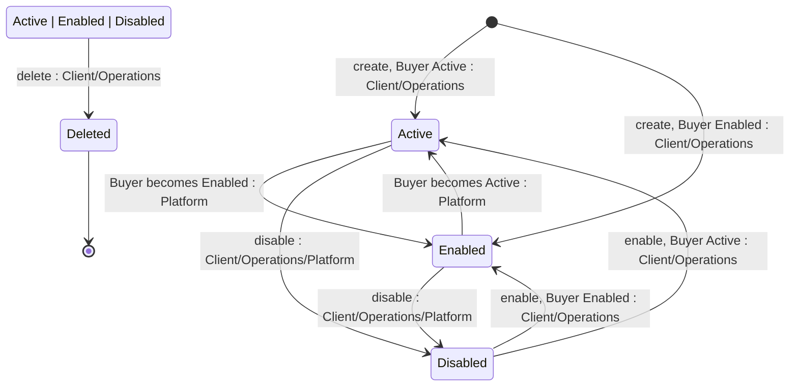

## State diagram

## States

<table>
  <thead>
    <tr>
      <th>State</th>
      <th>Description</th>
      <th>Initial State?</th>
      <th>Terminal State?</th>
    </tr>
  </thead>
  <tbody>
    <tr>
      <td>Active</td>
      <td>The Licensee is linked to an Active Buyer — one correctly linked to an ERP customer record. Only an Active Licensee may be used to place new Orders.</td>
      <td>Yes*</td>
      <td>No</td>
    </tr>
    <tr>
      <td>Enabled</td>
      <td>The Licensee is linked to an Enabled Buyer — one enabled without ERP activation. It cannot be used to place new Orders.</td>
      <td>Yes*</td>
      <td>No</td>
    </tr>
    <tr>
      <td>Disabled</td>
      <td>Set explicitly by a Client or Operations action, or automatically when the related Buyer or Seller is disabled. Cannot be used for new Orders, but remains usable for change and termination Orders against existing Agreements. Retained for historical reference.</td>
      <td>No</td>
      <td>No</td>
    </tr>
    <tr>
      <td>Deleted</td>
      <td>Soft-deleted. The record is retained but no longer usable, and is visible only to Operations.</td>
      <td>No</td>
      <td>Yes</td>
    </tr>
  </tbody>
</table>

## Transitions

<table>
  <thead>
    <tr>
      <th>ID</th>
      <th>From State</th>
      <th>To State</th>
      <th>Action</th>
      <th>Endpoint / Verb</th>
      <th>Actor</th>
      <th>Precondition</th>
      <th>Notes</th>
    </tr>
  </thead>
  <tbody>
    <tr>
      <td>T1a</td>
      <td>—</td>
      <td>Active</td>
      <td>Create (Buyer Active)</td>
      <td>`POST /v1/accounts/licensees`</td>
      <td>Client (own Account) or Operations</td>
      <td>An ErpLink exists on the (Buyer, Seller) pair and is neither Blocked nor Disabled; the Buyer is Active</td>
      <td>Accepts `application/json` or `multipart/form-data` (optional icon). Initial status mirrors the Buyer.</td>
    </tr>
    <tr>
      <td>T1b</td>
      <td>—</td>
      <td>Enabled</td>
      <td>Create (Buyer Enabled)</td>
      <td>`POST /v1/accounts/licensees`</td>
      <td>Client (own Account) or Operations</td>
      <td>An ErpLink exists on the (Buyer, Seller) pair and is neither Blocked nor Disabled; the Buyer is Enabled</td>
      <td>Initial status mirrors the Buyer.</td>
    </tr>
    <tr>
      <td>T2</td>
      <td>Enabled</td>
      <td>Active</td>
      <td>Activate (Buyer becomes Active)</td>
      <td>(no endpoint — propagated at Buyer synchronisation)</td>
      <td>Platform</td>
      <td>The related Buyer moves to Active (ERP customer identifier assigned)</td>
      <td>Automated; not exposed in either portal.</td>
    </tr>
    <tr>
      <td>T3</td>
      <td>Active</td>
      <td>Enabled</td>
      <td>Downgrade (Buyer becomes Enabled)</td>
      <td>(no endpoint — propagated at Buyer synchronisation)</td>
      <td>Platform</td>
      <td>The ERP customer identifier is removed from the related Buyer</td>
      <td>Automated; not exposed in either portal.</td>
    </tr>
    <tr>
      <td>T4a</td>
      <td>Active</td>
      <td>Disabled</td>
      <td>Disable</td>
      <td>`POST /v1/accounts/licensees/{id}/disable`</td>
      <td>Client (own Account) or Operations</td>
      <td>Not already Disabled or Deleted</td>
      <td>Also driven by the Platform when the related Buyer or Seller is disabled. Records the `disabled` audit timestamp.</td>
    </tr>
    <tr>
      <td>T4b</td>
      <td>Enabled</td>
      <td>Disabled</td>
      <td>Disable</td>
      <td>`POST /v1/accounts/licensees/{id}/disable`</td>
      <td>Client (own Account) or Operations</td>
      <td>Not already Disabled or Deleted</td>
      <td>As T4a.</td>
    </tr>
    <tr>
      <td>T5a</td>
      <td>Disabled</td>
      <td>Active</td>
      <td>Enable (Buyer Active)</td>
      <td>`POST /v1/accounts/licensees/{id}/enable`</td>
      <td>Client (own Account) or Operations</td>
      <td>The related Seller is Active or Offline; the ErpLink on the (Buyer, Seller) pair exists and is Active; the related Buyer is Active</td>
      <td>Enable re-derives the target status from the Buyer — see BR-007.</td>
    </tr>
    <tr>
      <td>T5b</td>
      <td>Disabled</td>
      <td>Enabled</td>
      <td>Enable (Buyer Enabled)</td>
      <td>`POST /v1/accounts/licensees/{id}/enable`</td>
      <td>Client (own Account) or Operations</td>
      <td>The related Seller is Active or Offline; the ErpLink on the (Buyer, Seller) pair exists and is Active; the related Buyer is Enabled</td>
      <td>As T5a.</td>
    </tr>
    <tr>
      <td>T6a</td>
      <td>Active</td>
      <td>Deleted</td>
      <td>Delete</td>
      <td>`DELETE /v1/accounts/licensees/{id}`</td>
      <td>Client (own Account) or Operations</td>
      <td>No related Commerce: Agreement in a non-terminal state — see BR-013</td>
      <td>Soft-delete (returns 204); record retained, visible to Operations only. Also propagated when the related Buyer is deleted. Terminal.</td>
    </tr>
    <tr>
      <td>T6b</td>
      <td>Enabled</td>
      <td>Deleted</td>
      <td>Delete</td>
      <td>`DELETE /v1/accounts/licensees/{id}`</td>
      <td>Client (own Account) or Operations</td>
      <td>No related Commerce: Agreement in a non-terminal state — see BR-013</td>
      <td>As T6a.</td>
    </tr>
    <tr>
      <td>T6c</td>
      <td>Disabled</td>
      <td>Deleted</td>
      <td>Delete</td>
      <td>`DELETE /v1/accounts/licensees/{id}`</td>
      <td>Client (own Account) or Operations</td>
      <td>No related Commerce: Agreement in a non-terminal state — see BR-013</td>
      <td>As T6a.</td>
    </tr>
  </tbody>
</table>

