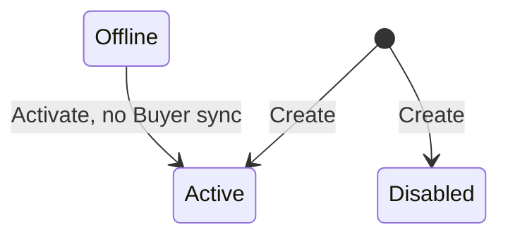

## State diagram

## States

<table>
  <thead>
    <tr>
      <th>State</th>
      <th>Description</th>
      <th>Initial State?</th>
      <th>Terminal State?</th>
    </tr>
  </thead>
  <tbody>
    <tr>
      <td>Active</td>
      <td>The Seller is operational. Available as the Owner on new Authorizations and as the transacting party on new Listings and Orders.</td>
      <td>Yes (default)</td>
      <td>No</td>
    </tr>
    <tr>
      <td>Disabled</td>
      <td>The Seller is inactive. Observed on legacy entities — typically SoftwareOne legal entities that have been superseded following an acquisition or ERP consolidation. New Orders are blocked under any Listing referencing a Disabled Seller.</td>
      <td>Yes (may be created directly into this status)</td>
      <td>No</td>
    </tr>
    <tr>
      <td>Offline</td>
      <td>Reached only from `Active`, via the Deactivate action (e.g. for maintenance). Returns to `Active` via the Activate action. No downstream Buyer-synchronization effect is triggered by entering or leaving this state (unlike Disabled).</td>
      <td>No</td>
      <td>No</td>
    </tr>
    <tr>
      <td>Deleted</td>
      <td>Reached only from `Active`, via the Delete action. A soft-delete: the Seller record is not removed and remains retrievable via the API — including in standard list responses — with `status: &quot;Deleted&quot;`. No transition out of this state exists. A Deleted Seller cannot be referenced when forming a new Buyer:Seller relationship.</td>
      <td>No</td>
      <td>Yes</td>
    </tr>
  </tbody>
</table>

## Transitions

<table>
  <thead>
    <tr>
      <th>ID</th>
      <th>From State</th>
      <th>To State</th>
      <th>Action</th>
      <th>Endpoint / Verb</th>
      <th>Actor</th>
      <th>Precondition</th>
      <th>Notes</th>
    </tr>
  </thead>
  <tbody>
    <tr>
      <td>T1a</td>
      <td>—</td>
      <td>Active</td>
      <td>Create</td>
      <td>`POST /v1/accounts/sellers`</td>
      <td>Operations</td>
      <td>None</td>
      <td>Initial status defaults to `Active` if omitted from the request.</td>
    </tr>
    <tr>
      <td>T1b</td>
      <td>—</td>
      <td>Disabled</td>
      <td>Create</td>
      <td>`POST /v1/accounts/sellers`</td>
      <td>Operations</td>
      <td>None</td>
      <td>Created directly into `Disabled` by supplying that value explicitly.</td>
    </tr>
    <tr>
      <td>T2</td>
      <td>Active</td>
      <td>Disabled</td>
      <td>Disable Seller</td>
      <td>`POST /v1/accounts/sellers/{id}/disable`</td>
      <td>Operations</td>
      <td>No related Licensee in `Active` or `Enabled` status (BR-007)</td>
      <td>Triggers Buyer synchronization and ERP cache invalidation.</td>
    </tr>
    <tr>
      <td>T3</td>
      <td>Active</td>
      <td>Offline</td>
      <td>Deactivate Seller</td>
      <td>`POST /v1/accounts/sellers/{id}/deactivate`</td>
      <td>Operations</td>
      <td>No related Licensee in `Active` or `Enabled` status (BR-007)</td>
      <td>Triggers ERP cache invalidation only — does not trigger Buyer synchronization.</td>
    </tr>
    <tr>
      <td>T4a</td>
      <td>Disabled</td>
      <td>Active</td>
      <td>Activate Seller</td>
      <td>`POST /v1/accounts/sellers/{id}/activate`</td>
      <td>Operations</td>
      <td>No related Licensee in `Active` or `Enabled` status (BR-007)</td>
      <td>Triggers Buyer synchronization (source status was `Disabled`) and ERP cache invalidation.</td>
    </tr>
    <tr>
      <td>T4b</td>
      <td>Offline</td>
      <td>Active</td>
      <td>Activate Seller</td>
      <td>`POST /v1/accounts/sellers/{id}/activate`</td>
      <td>Operations</td>
      <td>No related Licensee in `Active` or `Enabled` status (BR-007)</td>
      <td>Triggers ERP cache invalidation only — does not trigger Buyer synchronization (source status was `Offline`, not `Disabled`).</td>
    </tr>
    <tr>
      <td>T5</td>
      <td>Active</td>
      <td>Deleted</td>
      <td>Delete Seller</td>
      <td>`DELETE /v1/accounts/sellers/{id}` (returns 204)</td>
      <td>Operations</td>
      <td>No related Licensee in `Active` or `Enabled` status (BR-007)</td>
      <td>Soft-delete — see BR-001. Triggers Buyer synchronization and ERP cache invalidation. Terminal; no further transitions exist out of `Deleted`.</td>
    </tr>
  </tbody>
</table>

