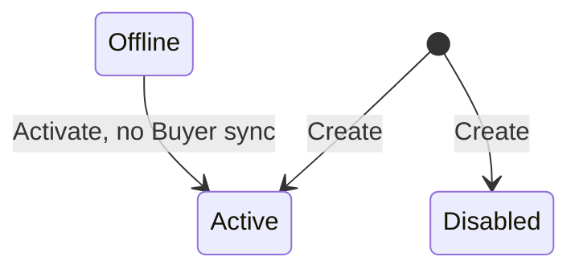

## State diagram

<table>
  <thead>
    <tr>

      <th>State</th>

      <th>Description</th>

      <th>Initial State?</th>

      <th>Terminal State?</th>

    </tr>
  </thead>
  <tbody>

    <tr>

      <td>Active</td>

      <td>The Seller is operational. Available as the Owner on new Authorizations and as the transacting party on new Listings and Orders.</td>

      <td>Yes (default)</td>

      <td>No</td>

    </tr>

    <tr>

      <td>Disabled</td>

      <td>The Seller is inactive. Observed on legacy entities — typically SoftwareOne legal entities that have been superseded following an acquisition or ERP consolidation. New Orders are blocked under any Listing referencing a Disabled Seller.</td>

      <td>Yes (may be created directly into this status)</td>

      <td>No</td>

    </tr>

    <tr>

      <td>Offline</td>

      <td>Reached only from `Active`, via the Deactivate action (e.g. for maintenance). Returns to `Active` via the Activate action. No downstream Buyer-synchronization effect is triggered by entering or leaving this state (unlike Disabled).</td>

      <td>No</td>

      <td>No</td>

    </tr>

    <tr>

      <td>Deleted</td>

      <td>Reached only from `Active`, via the Delete action. A soft-delete: the Seller record is not removed and remains retrievable via the API — including in standard list responses — with `status: &quot;Deleted&quot;`. No transition out of this state exists. A Deleted Seller cannot be referenced when forming a new Buyer:Seller relationship.</td>

      <td>No</td>

      <td>Yes</td>

    </tr>

  </tbody>
</table>

