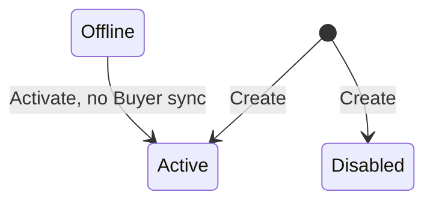

## State diagram

| State | Description | Initial State? | Terminal State? |
| --- | --- | --- | --- |

| Active | The Seller is operational. Available as the Owner on new Authorizations and as the transacting party on new Listings and Orders. | Yes (default) | No |

| Disabled | The Seller is inactive. Observed on legacy entities — typically SoftwareOne legal entities that have been superseded following an acquisition or ERP consolidation. New Orders are blocked under any Listing referencing a Disabled Seller. | Yes (may be created directly into this status) | No |

| Offline | Reached only from `Active`, via the Deactivate action (e.g. for maintenance). Returns to `Active` via the Activate action. No downstream Buyer-synchronization effect is triggered by entering or leaving this state (unlike Disabled). | No | No |

| Deleted | Reached only from `Active`, via the Delete action. A soft-delete: the Seller record is not removed and remains retrievable via the API — including in standard list responses — with `status: "Deleted"`. No transition out of this state exists. A Deleted Seller cannot be referenced when forming a new Buyer:Seller relationship. | No | Yes |

