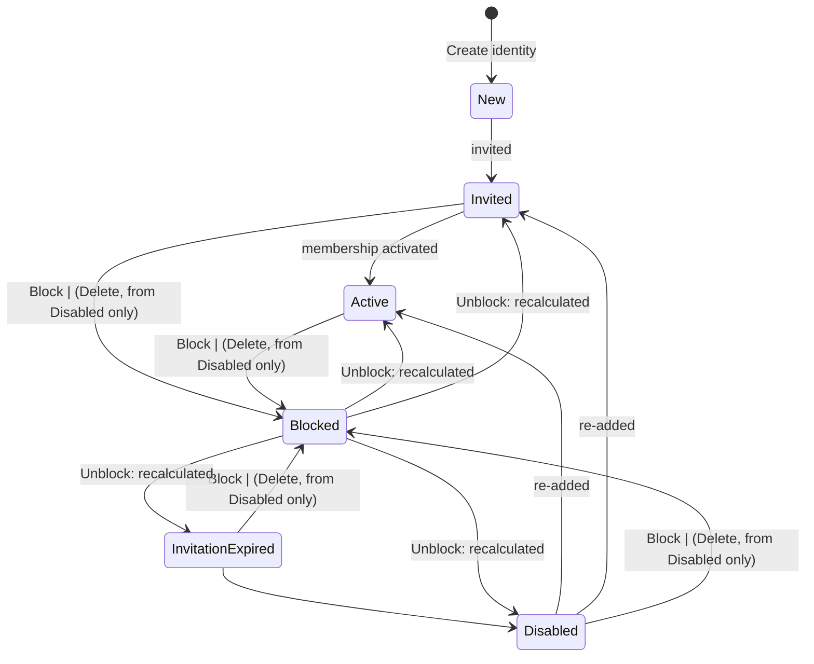

## Diagram

## States

<table>
  <thead>
    <tr>
      <th>State</th>
      <th>Description</th>
      <th>Initial State?</th>
      <th>Terminal State?</th>
    </tr>
  </thead>
  <tbody>
    <tr>
      <td>New</td>
      <td>Transient initial state the instant a global identity is created, before any Account membership has been recorded against it. Not observed via the API in practice — creation immediately attaches the first membership and recalculates the status.</td>
      <td>Yes</td>
      <td>No</td>
    </tr>
    <tr>
      <td>Invited</td>
      <td>The User&#39;s highest-priority Account membership is a pending invitation. The person has been invited into at least one Account but has not yet accepted/activated anywhere with higher priority.</td>
      <td>No</td>
      <td>No</td>
    </tr>
    <tr>
      <td>InvitationExpired</td>
      <td>The User&#39;s highest-priority Account membership is an expired invitation, with no active or still-pending membership taking precedence.</td>
      <td>No</td>
      <td>No</td>
    </tr>
    <tr>
      <td>Active</td>
      <td>The User has at least one active Account membership. This is the normal operating state.</td>
      <td>No</td>
      <td>No</td>
    </tr>
    <tr>
      <td>Blocked</td>
      <td>The User has been administratively blocked. This overrides the membership-derived status and prevents the person from authenticating to the platform. Reached only via the Block action; left only via Unblock.</td>
      <td>No</td>
      <td>No</td>
    </tr>
    <tr>
      <td>Disabled</td>
      <td>The User has no active or pending Account memberships (all memberships removed, deleted, or never activated). The identity persists but is dormant. This is the only state from which the identity may be deleted.</td>
      <td>No</td>
      <td>No</td>
    </tr>
    <tr>
      <td>Deleted</td>
      <td>The identity has been deleted — a soft-delete: status is set to `Deleted` and the record is retained. A `Deleted` User remains retrievable by Operations (by ID) but is excluded from Vendor and Client reads. Reached only from `Disabled`; no transition out.</td>
      <td>No</td>
      <td>Yes</td>
    </tr>
  </tbody>
</table>

## Transitions

<table>
  <thead>
    <tr>
      <th>ID</th>
      <th>To State</th>
      <th>Endpoint / Verb</th>
    </tr>
  </thead>
  <tbody>
    <tr>
      <td>T1</td>
      <td>New</td>
      <td>`POST /v1/accounts/{accountId}/users` (Account User invite — no dedicated global-User create endpoint)</td>
    </tr>
    <tr>
      <td>T2</td>
      <td>Invited</td>
      <td>No dedicated User endpoint — recalculated from Account membership creation</td>
    </tr>
    <tr>
      <td>T3</td>
      <td>Active</td>
      <td>No dedicated User endpoint — recalculated from Account membership change</td>
    </tr>
    <tr>
      <td>T4</td>
      <td>InvitationExpired</td>
      <td>No dedicated User endpoint — recalculated from Account membership change</td>
    </tr>
    <tr>
      <td>T5</td>
      <td>Invited</td>
      <td>No dedicated User endpoint — recalculated from Account membership change</td>
    </tr>
    <tr>
      <td>T6</td>
      <td>Invited</td>
      <td>No dedicated User endpoint — recalculated from Account membership change</td>
    </tr>
    <tr>
      <td>T7</td>
      <td>InvitationExpired</td>
      <td>No dedicated User endpoint — recalculated from Account membership change</td>
    </tr>
    <tr>
      <td>T8</td>
      <td>Disabled</td>
      <td>No dedicated User endpoint — recalculated from Account membership change</td>
    </tr>
    <tr>
      <td>T9</td>
      <td>Active</td>
      <td>No dedicated User endpoint — recalculated from Account membership change</td>
    </tr>
    <tr>
      <td>T10</td>
      <td>Invited</td>
      <td>No dedicated User endpoint — recalculated from Account membership change</td>
    </tr>
    <tr>
      <td>T11</td>
      <td>Blocked</td>
      <td>`POST /v1/accounts/users/{uniqueFilter}/block`</td>
    </tr>
    <tr>
      <td>T12</td>
      <td>Blocked</td>
      <td>`POST /v1/accounts/users/{uniqueFilter}/block`</td>
    </tr>
    <tr>
      <td>T13</td>
      <td>Blocked</td>
      <td>`POST /v1/accounts/users/{uniqueFilter}/block`</td>
    </tr>
    <tr>
      <td>T14</td>
      <td>Blocked</td>
      <td>`POST /v1/accounts/users/{uniqueFilter}/block`</td>
    </tr>
    <tr>
      <td>T15</td>
      <td>Active</td>
      <td>`POST /v1/accounts/users/{uniqueFilter}/unblock`</td>
    </tr>
    <tr>
      <td>T16</td>
      <td>Invited</td>
      <td>`POST /v1/accounts/users/{uniqueFilter}/unblock`</td>
    </tr>
    <tr>
      <td>T17</td>
      <td>InvitationExpired</td>
      <td>`POST /v1/accounts/users/{uniqueFilter}/unblock`</td>
    </tr>
    <tr>
      <td>T18</td>
      <td>Disabled</td>
      <td>`POST /v1/accounts/users/{uniqueFilter}/unblock`</td>
    </tr>
    <tr>
      <td>T19</td>
      <td>Deleted</td>
      <td>`DELETE /v1/accounts/users/{uniqueFilter}` (returns 204)</td>
    </tr>
  </tbody>
</table>

