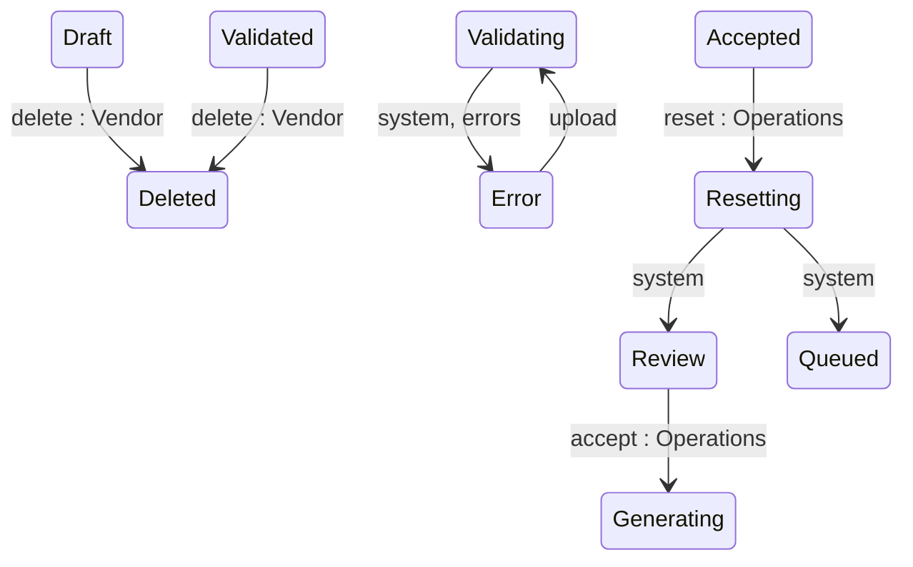

## State diagram

| State | Description | Initial State? | Terminal State? |
| --- | --- | --- | --- |

| Draft | Journal created; awaiting a charge-data upload. | Yes | No |

| Validating | Uploaded charges are being processed, enriched, and validated. Transient. | No | No |

| Validated | All charges processed with no upload errors; ready for the Vendor to submit to SoftwareOne. | No | No |

| Error | Charge processing finished with one or more errors, or a critical processing failure occurred. | No | No |

| Review | Submitted to SoftwareOne; awaiting Operations adjudication. | No | No |

| Enquiring | Returned to the Vendor for clarification or correction. | No | No |

| Reconciling | An Operations reconciliation action on one or more charges is in progress; awaiting recalculate. | No | No |

| Generating | Accepted; Ledgers are being created (one per Seller). Transient. | No | No |

| Generated | All Ledgers created; awaiting per-Ledger review and acceptance. | No | No |

| Accepted | All Ledgers generated. | No | No |

| Queued | Ledgers queued for downstream statement issuance. | No | No |

| Resetting | A reset is removing generated Ledgers and their Statements. Transient. | No | No |

| Completed | All Ledgers completed; the Journal is finalised. | No | Yes |

| Deleted | Permanently removed — no longer retrievable via the API. | No | Yes |

