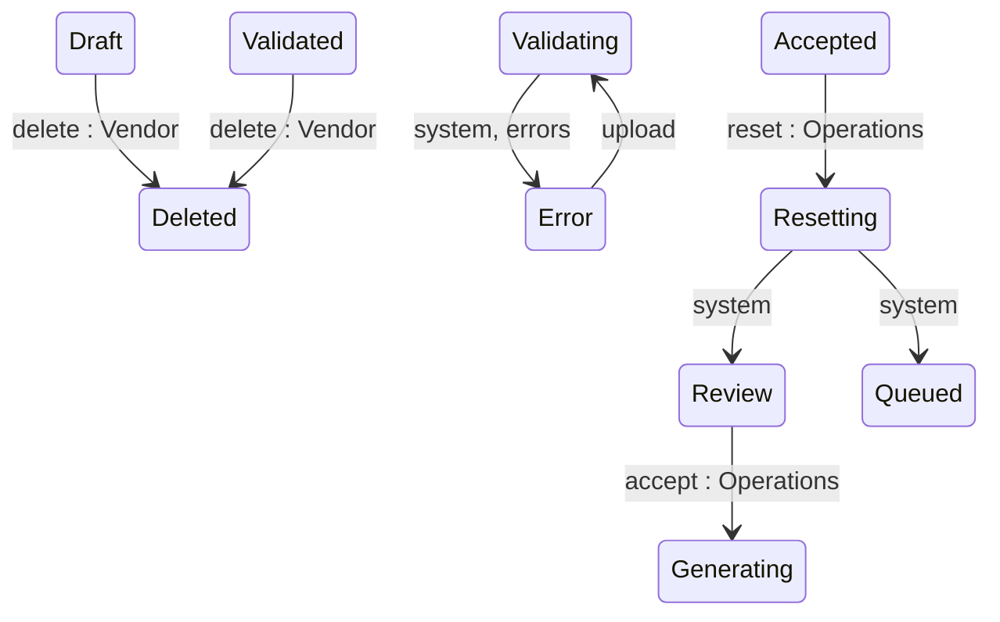

## State diagram

<table>
  <thead>
    <tr>

      <th>State</th>

      <th>Description</th>

      <th>Initial State?</th>

      <th>Terminal State?</th>

    </tr>
  </thead>
  <tbody>

    <tr>

      <td>Draft</td>

      <td>Journal created; awaiting a charge-data upload.</td>

      <td>Yes</td>

      <td>No</td>

    </tr>

    <tr>

      <td>Validating</td>

      <td>Uploaded charges are being processed, enriched, and validated. Transient.</td>

      <td>No</td>

      <td>No</td>

    </tr>

    <tr>

      <td>Validated</td>

      <td>All charges processed with no upload errors; ready for the Vendor to submit to SoftwareOne.</td>

      <td>No</td>

      <td>No</td>

    </tr>

    <tr>

      <td>Error</td>

      <td>Charge processing finished with one or more errors, or a critical processing failure occurred.</td>

      <td>No</td>

      <td>No</td>

    </tr>

    <tr>

      <td>Review</td>

      <td>Submitted to SoftwareOne; awaiting Operations adjudication.</td>

      <td>No</td>

      <td>No</td>

    </tr>

    <tr>

      <td>Enquiring</td>

      <td>Returned to the Vendor for clarification or correction.</td>

      <td>No</td>

      <td>No</td>

    </tr>

    <tr>

      <td>Reconciling</td>

      <td>An Operations reconciliation action on one or more charges is in progress; awaiting recalculate.</td>

      <td>No</td>

      <td>No</td>

    </tr>

    <tr>

      <td>Generating</td>

      <td>Accepted; Ledgers are being created (one per Seller). Transient.</td>

      <td>No</td>

      <td>No</td>

    </tr>

    <tr>

      <td>Generated</td>

      <td>All Ledgers created; awaiting per-Ledger review and acceptance.</td>

      <td>No</td>

      <td>No</td>

    </tr>

    <tr>

      <td>Accepted</td>

      <td>All Ledgers generated.</td>

      <td>No</td>

      <td>No</td>

    </tr>

    <tr>

      <td>Queued</td>

      <td>Ledgers queued for downstream statement issuance.</td>

      <td>No</td>

      <td>No</td>

    </tr>

    <tr>

      <td>Resetting</td>

      <td>A reset is removing generated Ledgers and their Statements. Transient.</td>

      <td>No</td>

      <td>No</td>

    </tr>

    <tr>

      <td>Completed</td>

      <td>All Ledgers completed; the Journal is finalised.</td>

      <td>No</td>

      <td>Yes</td>

    </tr>

    <tr>

      <td>Deleted</td>

      <td>Permanently removed — no longer retrievable via the API.</td>

      <td>No</td>

      <td>Yes</td>

    </tr>

  </tbody>
</table>

