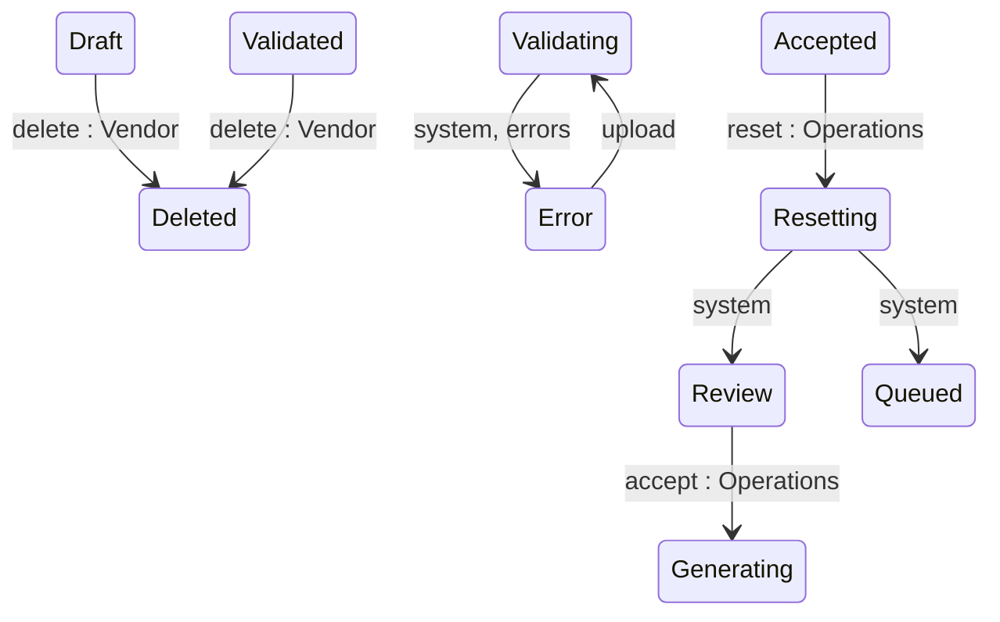

## Diagram

## States

<table>
  <thead>
    <tr>
      <th>State</th>
      <th>Description</th>
      <th>Initial State?</th>
      <th>Terminal State?</th>
    </tr>
  </thead>
  <tbody>
    <tr>
      <td>Draft</td>
      <td>Journal created; awaiting a charge-data upload.</td>
      <td>Yes</td>
      <td>No</td>
    </tr>
    <tr>
      <td>Validating</td>
      <td>Uploaded charges are being processed, enriched, and validated. Transient.</td>
      <td>No</td>
      <td>No</td>
    </tr>
    <tr>
      <td>Validated</td>
      <td>All charges processed with no upload errors; ready for the Vendor to submit to SoftwareOne.</td>
      <td>No</td>
      <td>No</td>
    </tr>
    <tr>
      <td>Error</td>
      <td>Charge processing finished with one or more errors, or a critical processing failure occurred.</td>
      <td>No</td>
      <td>No</td>
    </tr>
    <tr>
      <td>Review</td>
      <td>Submitted to SoftwareOne; awaiting Operations adjudication.</td>
      <td>No</td>
      <td>No</td>
    </tr>
    <tr>
      <td>Enquiring</td>
      <td>Returned to the Vendor for clarification or correction.</td>
      <td>No</td>
      <td>No</td>
    </tr>
    <tr>
      <td>Reconciling</td>
      <td>An Operations reconciliation action on one or more charges is in progress; awaiting recalculate.</td>
      <td>No</td>
      <td>No</td>
    </tr>
    <tr>
      <td>Generating</td>
      <td>Accepted; Ledgers are being created (one per Seller). Transient.</td>
      <td>No</td>
      <td>No</td>
    </tr>
    <tr>
      <td>Generated</td>
      <td>All Ledgers created; awaiting per-Ledger review and acceptance.</td>
      <td>No</td>
      <td>No</td>
    </tr>
    <tr>
      <td>Accepted</td>
      <td>All Ledgers generated.</td>
      <td>No</td>
      <td>No</td>
    </tr>
    <tr>
      <td>Queued</td>
      <td>Ledgers queued for downstream statement issuance.</td>
      <td>No</td>
      <td>No</td>
    </tr>
    <tr>
      <td>Resetting</td>
      <td>A reset is removing generated Ledgers and their Statements. Transient.</td>
      <td>No</td>
      <td>No</td>
    </tr>
    <tr>
      <td>Completed</td>
      <td>All Ledgers completed; the Journal is finalised.</td>
      <td>No</td>
      <td>Yes</td>
    </tr>
    <tr>
      <td>Deleted</td>
      <td>Permanently removed — no longer retrievable via the API.</td>
      <td>No</td>
      <td>Yes</td>
    </tr>
  </tbody>
</table>

## Transitions

<table>
  <thead>
    <tr>
      <th>ID</th>
      <th>To State</th>
      <th>Endpoint / Verb</th>
    </tr>
  </thead>
  <tbody>
    <tr>
      <td>T1</td>
      <td>Draft</td>
      <td>`POST` (base collection endpoint)</td>
    </tr>
    <tr>
      <td>T2</td>
      <td>Validating</td>
      <td>`upload`</td>
    </tr>
    <tr>
      <td>T3</td>
      <td>Validating</td>
      <td>`upload`</td>
    </tr>
    <tr>
      <td>T4</td>
      <td>Validating</td>
      <td>`upload`</td>
    </tr>
    <tr>
      <td>T5</td>
      <td>Validating</td>
      <td>`upload`</td>
    </tr>
    <tr>
      <td>T6</td>
      <td>Validated</td>
      <td>system (automatic)</td>
    </tr>
    <tr>
      <td>T7</td>
      <td>Error</td>
      <td>system (automatic)</td>
    </tr>
    <tr>
      <td>T8</td>
      <td>Review</td>
      <td>system (automatic)</td>
    </tr>
    <tr>
      <td>T9</td>
      <td>Review</td>
      <td>`submit`</td>
    </tr>
    <tr>
      <td>T10</td>
      <td>Review</td>
      <td>`submit`</td>
    </tr>
    <tr>
      <td>T11</td>
      <td>Enquiring</td>
      <td>`enquiry`</td>
    </tr>
    <tr>
      <td>T12</td>
      <td>Reconciling</td>
      <td>charge match / ignore / reset action (no dedicated Journal endpoint)</td>
    </tr>
    <tr>
      <td>T13</td>
      <td>Validating</td>
      <td>`recalculate`</td>
    </tr>
    <tr>
      <td>T14</td>
      <td>Validating</td>
      <td>`regenerate`</td>
    </tr>
    <tr>
      <td>T15</td>
      <td>Validating</td>
      <td>`regenerate`</td>
    </tr>
    <tr>
      <td>T16</td>
      <td>Generating</td>
      <td>`accept`</td>
    </tr>
    <tr>
      <td>T17</td>
      <td>Generated</td>
      <td>system (automatic)</td>
    </tr>
    <tr>
      <td>T18</td>
      <td>Review</td>
      <td>system (automatic)</td>
    </tr>
    <tr>
      <td>T19</td>
      <td>Accepted</td>
      <td>system (automatic)</td>
    </tr>
    <tr>
      <td>T20</td>
      <td>Queued</td>
      <td>system (automatic)</td>
    </tr>
    <tr>
      <td>T21</td>
      <td>Queued</td>
      <td>system (automatic)</td>
    </tr>
    <tr>
      <td>T22</td>
      <td>Completed</td>
      <td>system (automatic)</td>
    </tr>
    <tr>
      <td>T23</td>
      <td>Resetting</td>
      <td>`reset`</td>
    </tr>
    <tr>
      <td>T24</td>
      <td>Resetting</td>
      <td>`reset`</td>
    </tr>
    <tr>
      <td>T25</td>
      <td>Review</td>
      <td>system (automatic)</td>
    </tr>
    <tr>
      <td>T26</td>
      <td>Deleted</td>
      <td>`delete`</td>
    </tr>
    <tr>
      <td>T27</td>
      <td>Deleted</td>
      <td>`delete`</td>
    </tr>
    <tr>
      <td>T28</td>
      <td>Deleted</td>
      <td>`delete`</td>
    </tr>
    <tr>
      <td>T29</td>
      <td>Deleted</td>
      <td>`delete`</td>
    </tr>
  </tbody>
</table>

