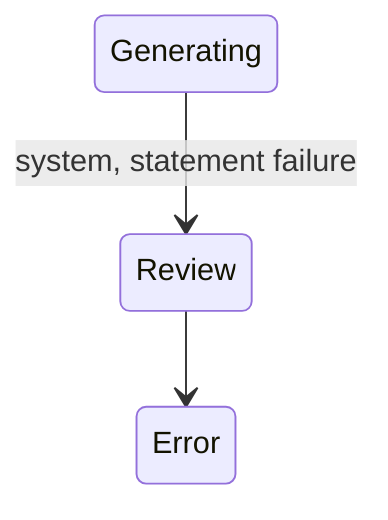

## Diagram

## States

<table>
  <thead>
    <tr>
      <th>State</th>
      <th>Description</th>
      <th>Initial State?</th>
      <th>Terminal State?</th>
    </tr>
  </thead>
  <tbody>
    <tr>
      <td>Review</td>
      <td>Charges rated with no errors; the Ledger is awaiting Operations acceptance.</td>
      <td>Yes</td>
      <td>No</td>
    </tr>
    <tr>
      <td>Error</td>
      <td>Rating completed with one or more charge errors, or a critical rating/processing failure occurred. Recalculate can re-run rating from here.</td>
      <td>Yes</td>
      <td>No</td>
    </tr>
    <tr>
      <td>Rating</td>
      <td>The rating function is (re)computing the Ledger&#39;s rated charges and pricing roll-ups. Transient; reached via recalculate.</td>
      <td>No</td>
      <td>No</td>
    </tr>
    <tr>
      <td>Generating</td>
      <td>Accepted; Statements are being created (one per Agreement). Transient.</td>
      <td>No</td>
      <td>No</td>
    </tr>
    <tr>
      <td>Generated</td>
      <td>All Statements created; the Ledger is awaiting queue for ERP integration.</td>
      <td>No</td>
      <td>No</td>
    </tr>
    <tr>
      <td>Queued</td>
      <td>Queued for ERP integration; the Ledger&#39;s Statements have been pushed to the ERP.</td>
      <td>No</td>
      <td>No</td>
    </tr>
    <tr>
      <td>Completed</td>
      <td>All of the Ledger&#39;s Statements reached a final status; the Ledger is finalised.</td>
      <td>No</td>
      <td>Yes</td>
    </tr>
  </tbody>
</table>

## Transitions

<table>
  <thead>
    <tr>
      <th>From State</th>
      <th>To State</th>
      <th>Action</th>
      <th>Endpoint / Verb</th>
      <th>Actor</th>
    </tr>
  </thead>
  <tbody>
    <tr>
      <td>—</td>
      <td>Review</td>
      <td>Create (rated, no errors)</td>
      <td>system (via Journal `accept`)</td>
      <td>Operations</td>
    </tr>
    <tr>
      <td>—</td>
      <td>Error</td>
      <td>Create (rating errors)</td>
      <td>system (via Journal `accept`)</td>
      <td>Operations</td>
    </tr>
    <tr>
      <td>Review</td>
      <td>Rating</td>
      <td>Recalculate</td>
      <td>`recalculate`</td>
      <td>Operations</td>
    </tr>
    <tr>
      <td>Error</td>
      <td>Rating</td>
      <td>Recalculate</td>
      <td>`recalculate`</td>
      <td>Operations</td>
    </tr>
    <tr>
      <td>Rating</td>
      <td>Review</td>
      <td>Rating completed, no errors</td>
      <td>system (automatic)</td>
      <td>—</td>
    </tr>
    <tr>
      <td>Rating</td>
      <td>Error</td>
      <td>Rating completed with errors</td>
      <td>system (automatic)</td>
      <td>—</td>
    </tr>
    <tr>
      <td>Review</td>
      <td>Generating</td>
      <td>Accept</td>
      <td>`accept`</td>
      <td>Operations</td>
    </tr>
    <tr>
      <td>Generating</td>
      <td>Generated</td>
      <td>Statement creation succeeded</td>
      <td>system (automatic)</td>
      <td>—</td>
    </tr>
    <tr>
      <td>Generating</td>
      <td>Review</td>
      <td>Statement creation failed</td>
      <td>system (automatic)</td>
      <td>—</td>
    </tr>
    <tr>
      <td>Generated</td>
      <td>Queued</td>
      <td>Queue</td>
      <td>`queue`</td>
      <td>Operations</td>
    </tr>
    <tr>
      <td>Queued</td>
      <td>Completed</td>
      <td>All Statements completed</td>
      <td>system (automatic)</td>
      <td>—</td>
    </tr>
  </tbody>
</table>

