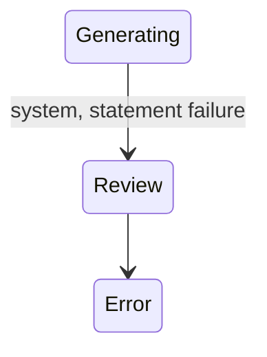

## State diagram

| State | Description | Initial State? | Terminal State? |
| --- | --- | --- | --- |

| Review | Charges rated with no errors; the Ledger is awaiting Operations acceptance. | Yes | No |

| Error | Rating completed with one or more charge errors, or a critical rating/processing failure occurred. Recalculate can re-run rating from here. | Yes | No |

| Rating | The rating function is (re)computing the Ledger's rated charges and pricing roll-ups. Transient; reached via recalculate. | No | No |

| Generating | Accepted; Statements are being created (one per Agreement). Transient. | No | No |

| Generated | All Statements created; the Ledger is awaiting queue for ERP integration. | No | No |

| Queued | Queued for ERP integration; the Ledger's Statements have been pushed to the ERP. | No | No |

| Completed | All of the Ledger's Statements reached a final status; the Ledger is finalised. | No | Yes |

