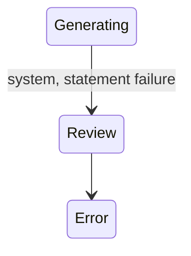

## State diagram

<table>
  <thead>
    <tr>

      <th>State</th>

      <th>Description</th>

      <th>Initial State?</th>

      <th>Terminal State?</th>

    </tr>
  </thead>
  <tbody>

    <tr>

      <td>Review</td>

      <td>Charges rated with no errors; the Ledger is awaiting Operations acceptance.</td>

      <td>Yes</td>

      <td>No</td>

    </tr>

    <tr>

      <td>Error</td>

      <td>Rating completed with one or more charge errors, or a critical rating/processing failure occurred. Recalculate can re-run rating from here.</td>

      <td>Yes</td>

      <td>No</td>

    </tr>

    <tr>

      <td>Rating</td>

      <td>The rating function is (re)computing the Ledger&#39;s rated charges and pricing roll-ups. Transient; reached via recalculate.</td>

      <td>No</td>

      <td>No</td>

    </tr>

    <tr>

      <td>Generating</td>

      <td>Accepted; Statements are being created (one per Agreement). Transient.</td>

      <td>No</td>

      <td>No</td>

    </tr>

    <tr>

      <td>Generated</td>

      <td>All Statements created; the Ledger is awaiting queue for ERP integration.</td>

      <td>No</td>

      <td>No</td>

    </tr>

    <tr>

      <td>Queued</td>

      <td>Queued for ERP integration; the Ledger&#39;s Statements have been pushed to the ERP.</td>

      <td>No</td>

      <td>No</td>

    </tr>

    <tr>

      <td>Completed</td>

      <td>All of the Ledger&#39;s Statements reached a final status; the Ledger is finalised.</td>

      <td>No</td>

      <td>Yes</td>

    </tr>

  </tbody>
</table>

