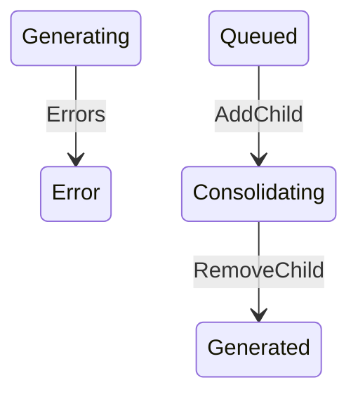

The Marketplace Platform provides three distinct user interfaces, namely the Client Portal, Vendor Portal, and Operations Portal. This topic describes how the account object transitions through different lifecycle states within the platform.


The diagrams show different transitions depending on whether the account is a Client/Partner or a Vendor, but the underlying statuses are the same.


## Diagram

## States

<table>
  <thead>
    <tr>
      <th>State</th>
      <th>Description</th>
      <th>Initial State?</th>
      <th>Terminal State?</th>
    </tr>
  </thead>
  <tbody>
    <tr>
      <td>Generated</td>
      <td>The Statement has been created (or re-enriched) and is awaiting queueing.</td>
      <td>Yes</td>
      <td>No</td>
    </tr>
    <tr>
      <td>Cancelled</td>
      <td>Excluded from billing. Reached either directly at creation (a blocked billing pairing) or by an explicit `cancel`.</td>
      <td>Yes</td>
      <td>Yes</td>
    </tr>
    <tr>
      <td>Queued</td>
      <td>Queued for ERP integration; also the required status for a standalone Statement to be added as a child of a Consolidated parent.</td>
      <td>No</td>
      <td>No</td>
    </tr>
    <tr>
      <td>Pending</td>
      <td>Awaiting further ERP-side processing after being queued.</td>
      <td>No</td>
      <td>No</td>
    </tr>
    <tr>
      <td>Issued</td>
      <td>Sent to the Client.</td>
      <td>No</td>
      <td>Yes</td>
    </tr>
    <tr>
      <td>Error</td>
      <td>A processing failure requiring attention; billing is blocked until recovered.</td>
      <td>No</td>
      <td>No</td>
    </tr>
    <tr>
      <td>Generating</td>
      <td>An Automated Statement&#39;s charges are being re-enriched following a `recalculate`. Transient.</td>
      <td>No</td>
      <td>No</td>
    </tr>
    <tr>
      <td>Consolidating</td>
      <td>A standalone Statement currently linked as a child of a Consolidated parent, pending the parent&#39;s own queueing.</td>
      <td>No</td>
      <td>No</td>
    </tr>
    <tr>
      <td>Consolidated</td>
      <td>A child Statement whose Consolidated parent has been queued; rolled into the parent&#39;s single ERP posting.</td>
      <td>No</td>
      <td>No</td>
    </tr>
  </tbody>
</table>

## Transitions

<table>
  <thead>
    <tr>
      <th>From State</th>
      <th>To State</th>
      <th>Action</th>
      <th>Endpoint / Verb</th>
      <th>Actor</th>
    </tr>
  </thead>
  <tbody>
    <tr>
      <td>—</td>
      <td>Generated</td>
      <td>Create</td>
      <td>No dedicated endpoint — automatic on [[Ledger]] acceptance (Automated) or Custom Ledger acceptance (Manual); or `POST /statements` (Consolidated only)</td>
      <td>System (Automated/Manual) or Operations (Consolidated)</td>
    </tr>
    <tr>
      <td>—</td>
      <td>Cancelled</td>
      <td>Create (blocked)</td>
      <td>No dedicated endpoint — automatic on Ledger/Custom Ledger acceptance</td>
      <td>System</td>
    </tr>
    <tr>
      <td>Generated</td>
      <td>Queued</td>
      <td>Queue</td>
      <td>`POST /statements/{id}/queue`</td>
      <td>Operations</td>
    </tr>
    <tr>
      <td>Error</td>
      <td>Queued</td>
      <td>Queue, Retry, or Recalculate (Manual billing type only)</td>
      <td>`POST .../queue`; `POST .../retry`; or `POST .../recalculate` (Manual only)</td>
      <td>Operations</td>
    </tr>
    <tr>
      <td>Queued</td>
      <td>Pending</td>
      <td>Move to pending</td>
      <td>`POST .../pending`</td>
      <td>Operations</td>
    </tr>
    <tr>
      <td>Pending</td>
      <td>Issued</td>
      <td>Issue</td>
      <td>`POST .../issue`</td>
      <td>Operations</td>
    </tr>
    <tr>
      <td>Queued</td>
      <td>Error</td>
      <td>Mark error</td>
      <td>`POST .../error`</td>
      <td>Operations</td>
    </tr>
    <tr>
      <td>Pending</td>
      <td>Error</td>
      <td>Mark error</td>
      <td>`POST .../error`</td>
      <td>Operations</td>
    </tr>
    <tr>
      <td>Queued</td>
      <td>Cancelled</td>
      <td>Cancel</td>
      <td>`POST .../cancel`</td>
      <td>Operations</td>
    </tr>
    <tr>
      <td>Pending</td>
      <td>Cancelled</td>
      <td>Cancel</td>
      <td>`POST .../cancel`</td>
      <td>Operations</td>
    </tr>
    <tr>
      <td>Error</td>
      <td>Cancelled</td>
      <td>Cancel</td>
      <td>`POST .../cancel`</td>
      <td>Operations</td>
    </tr>
    <tr>
      <td>Generated</td>
      <td>Cancelled</td>
      <td>Cancel</td>
      <td>`POST .../cancel`</td>
      <td>Operations</td>
    </tr>
    <tr>
      <td>Error</td>
      <td>Generating</td>
      <td>Recalculate (Automated billing type only)</td>
      <td>`POST .../recalculate`</td>
      <td>Operations</td>
    </tr>
    <tr>
      <td>Generating</td>
      <td>Queued</td>
      <td>Recalculation completed, no processing errors</td>
      <td>System (automatic)</td>
      <td>—</td>
    </tr>
    <tr>
      <td>Generating</td>
      <td>Error</td>
      <td>Recalculation completed with processing errors, or failed critically</td>
      <td>System (automatic)</td>
      <td>—</td>
    </tr>
    <tr>
      <td>Queued</td>
      <td>Consolidating</td>
      <td>Add child</td>
      <td>`POST /statements/{id}/children` (called on the Consolidated parent)</td>
      <td>Operations</td>
    </tr>
    <tr>
      <td>Consolidating</td>
      <td>Generated</td>
      <td>Remove child</td>
      <td>`DELETE /statements/{id}/children/{childId}` (called on the Consolidated parent)</td>
      <td>Operations</td>
    </tr>
    <tr>
      <td>Consolidating</td>
      <td>Consolidated</td>
      <td>Queue (called on the Consolidated parent)</td>
      <td>`POST /statements/{id}/queue`</td>
      <td>Operations</td>
    </tr>
    <tr>
      <td>Consolidating</td>
      <td>Queued</td>
      <td>Cancel (called on the Consolidated parent)</td>
      <td>`POST /statements/{id}/cancel`</td>
      <td>Operations</td>
    </tr>
    <tr>
      <td>Consolidated</td>
      <td>Queued</td>
      <td>Cancel (called on the Consolidated parent)</td>
      <td>`POST /statements/{id}/cancel`</td>
      <td>Operations</td>
    </tr>
  </tbody>
</table>

