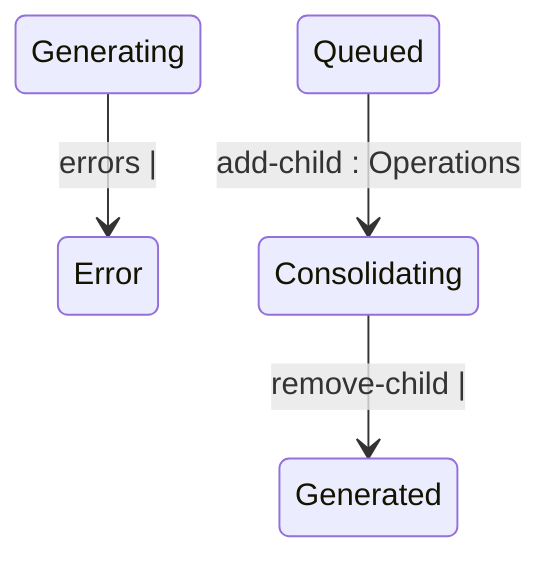

## State diagram

| State | Description | Initial State? | Terminal State? |
| --- | --- | --- | --- |

| Generated | The Statement has been created (or re-enriched) and is awaiting queueing. | Yes | No |

| Cancelled | Excluded from billing. Reached either directly at creation (a blocked billing pairing) or by an explicit `cancel`. | Yes | Yes |

| Queued | Queued for ERP integration; also the required status for a standalone Statement to be added as a child of a Consolidated parent. | No | No |

| Pending | Awaiting further ERP-side processing after being queued. | No | No |

| Issued | Sent to the Client. | No | Yes |

| Error | A processing failure requiring attention; billing is blocked until recovered. | No | No |

| Generating | An Automated Statement's charges are being re-enriched following a `recalculate`. Transient. | No | No |

| Consolidating | A standalone Statement currently linked as a child of a Consolidated parent, pending the parent's own queueing. | No | No |

| Consolidated | A child Statement whose Consolidated parent has been queued; rolled into the parent's single ERP posting. | No | No |

