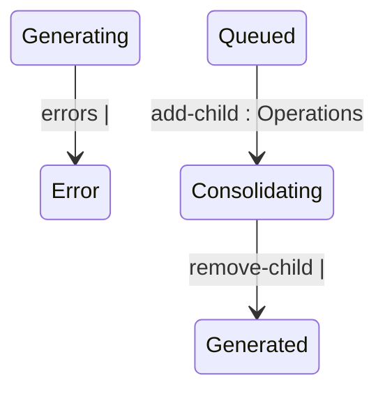

## State diagram

## States

<table>
  <thead>
    <tr>
      <th>State</th>
      <th>Description</th>
      <th>Initial State?</th>
      <th>Terminal State?</th>
    </tr>
  </thead>
  <tbody>
    <tr>
      <td>Generated</td>
      <td>The Statement has been created (or re-enriched) and is awaiting queueing.</td>
      <td>Yes</td>
      <td>No</td>
    </tr>
    <tr>
      <td>Cancelled</td>
      <td>Excluded from billing. Reached either directly at creation (a blocked billing pairing) or by an explicit `cancel`.</td>
      <td>Yes</td>
      <td>Yes</td>
    </tr>
    <tr>
      <td>Queued</td>
      <td>Queued for ERP integration; also the required status for a standalone Statement to be added as a child of a Consolidated parent.</td>
      <td>No</td>
      <td>No</td>
    </tr>
    <tr>
      <td>Pending</td>
      <td>Awaiting further ERP-side processing after being queued.</td>
      <td>No</td>
      <td>No</td>
    </tr>
    <tr>
      <td>Issued</td>
      <td>Sent to the Client.</td>
      <td>No</td>
      <td>Yes</td>
    </tr>
    <tr>
      <td>Error</td>
      <td>A processing failure requiring attention; billing is blocked until recovered.</td>
      <td>No</td>
      <td>No</td>
    </tr>
    <tr>
      <td>Generating</td>
      <td>An Automated Statement&#39;s charges are being re-enriched following a `recalculate`. Transient.</td>
      <td>No</td>
      <td>No</td>
    </tr>
    <tr>
      <td>Consolidating</td>
      <td>A standalone Statement currently linked as a child of a Consolidated parent, pending the parent&#39;s own queueing.</td>
      <td>No</td>
      <td>No</td>
    </tr>
    <tr>
      <td>Consolidated</td>
      <td>A child Statement whose Consolidated parent has been queued; rolled into the parent&#39;s single ERP posting.</td>
      <td>No</td>
      <td>No</td>
    </tr>
  </tbody>
</table>

## Transitions

<table>
  <thead>
    <tr>
      <th>ID</th>
      <th>From State</th>
      <th>To State</th>
      <th>Action</th>
      <th>Endpoint / Verb</th>
      <th>Actor</th>
      <th>Precondition</th>
      <th>Notes</th>
    </tr>
  </thead>
  <tbody>
    <tr>
      <td>T1</td>
      <td>—</td>
      <td>Generated</td>
      <td>Create</td>
      <td>No dedicated endpoint — automatic on [[Ledger]] acceptance (Automated) or Custom Ledger acceptance (Manual); or `POST /statements` (Consolidated only)</td>
      <td>System (Automated/Manual) or Operations (Consolidated)</td>
      <td>Ledger/Custom Ledger accepted and the Vendor/Client billing pairing is not blocked (Automated/Manual); none for a Consolidated shell</td>
      <td>One Automated Statement is created per distinct (Journal, Agreement, Buyer) combination in the accepted Ledger. A Consolidated Statement is created empty (no Agreement, zero statistics) and populated afterwards via T16.</td>
    </tr>
    <tr>
      <td>T2</td>
      <td>—</td>
      <td>Cancelled</td>
      <td>Create (blocked)</td>
      <td>No dedicated endpoint — automatic on Ledger/Custom Ledger acceptance</td>
      <td>System</td>
      <td>A manual billing override routes the Vendor/Client pairing to the other billing pipeline (or, Automated only, no Client could be resolved for the entry)</td>
      <td>Never occurs for a Consolidated Statement, which is always created directly in Generated. See BR-006.</td>
    </tr>
    <tr>
      <td>T3</td>
      <td>Generated</td>
      <td>Queued</td>
      <td>Queue</td>
      <td>`POST /statements/{id}/queue`</td>
      <td>Operations</td>
      <td>Generated</td>
      <td>For a Consolidated parent, requires at least one linked child (see T17).</td>
    </tr>
    <tr>
      <td>T4</td>
      <td>Error</td>
      <td>Queued</td>
      <td>Queue, Retry, or Recalculate (Manual billing type only)</td>
      <td>`POST .../queue`; `POST .../retry`; or `POST .../recalculate` (Manual only)</td>
      <td>Operations</td>
      <td>Error</td>
      <td>Three independent recovery mechanisms land on the same state. `recalculate` on a Manual Statement returns it to Queued with no re-enrichment (contrast T13/T14, Automated only).</td>
    </tr>
    <tr>
      <td>T5</td>
      <td>Queued</td>
      <td>Pending</td>
      <td>Move to pending</td>
      <td>`POST .../pending`</td>
      <td>Operations</td>
      <td>Queued</td>
      <td>—</td>
    </tr>
    <tr>
      <td>T6</td>
      <td>Pending</td>
      <td>Issued</td>
      <td>Issue</td>
      <td>`POST .../issue`</td>
      <td>Operations</td>
      <td>Pending</td>
      <td>Issued or Cancelled is what allows the originating Ledger/Custom Ledger to complete — see BR-013.</td>
    </tr>
    <tr>
      <td>T7</td>
      <td>Queued</td>
      <td>Error</td>
      <td>Mark error</td>
      <td>`POST .../error`</td>
      <td>Operations</td>
      <td>Queued</td>
      <td>—</td>
    </tr>
    <tr>
      <td>T8</td>
      <td>Pending</td>
      <td>Error</td>
      <td>Mark error</td>
      <td>`POST .../error`</td>
      <td>Operations</td>
      <td>Pending</td>
      <td>—</td>
    </tr>
    <tr>
      <td>T9</td>
      <td>Queued</td>
      <td>Cancelled</td>
      <td>Cancel</td>
      <td>`POST .../cancel`</td>
      <td>Operations</td>
      <td>Queued</td>
      <td>For a Consolidated parent, every linked child is instead detached and reset to Queued — see T19/T20, not this row.</td>
    </tr>
    <tr>
      <td>T10</td>
      <td>Pending</td>
      <td>Cancelled</td>
      <td>Cancel</td>
      <td>`POST .../cancel`</td>
      <td>Operations</td>
      <td>Pending</td>
      <td>—</td>
    </tr>
    <tr>
      <td>T11</td>
      <td>Error</td>
      <td>Cancelled</td>
      <td>Cancel</td>
      <td>`POST .../cancel`</td>
      <td>Operations</td>
      <td>Error</td>
      <td>—</td>
    </tr>
    <tr>
      <td>T12</td>
      <td>Generated</td>
      <td>Cancelled</td>
      <td>Cancel</td>
      <td>`POST .../cancel`</td>
      <td>Operations</td>
      <td>Generated</td>
      <td>—</td>
    </tr>
    <tr>
      <td>T13</td>
      <td>Error</td>
      <td>Generating</td>
      <td>Recalculate (Automated billing type only)</td>
      <td>`POST .../recalculate`</td>
      <td>Operations</td>
      <td>Error, BillingType = Automated</td>
      <td>Re-enriches the Statement&#39;s charges from the parent Journal; resolves automatically via T14/T15.</td>
    </tr>
    <tr>
      <td>T14</td>
      <td>Generating</td>
      <td>Queued</td>
      <td>Recalculation completed, no processing errors</td>
      <td>System (automatic)</td>
      <td>—</td>
      <td>All re-enriched charges processed without error</td>
      <td>—</td>
    </tr>
    <tr>
      <td>T15</td>
      <td>Generating</td>
      <td>Error</td>
      <td>Recalculation completed with processing errors, or failed critically</td>
      <td>System (automatic)</td>
      <td>—</td>
      <td>One or more re-enriched charges have a processing error, or the operation failed</td>
      <td>—</td>
    </tr>
    <tr>
      <td>T16</td>
      <td>Queued</td>
      <td>Consolidating</td>
      <td>Add child</td>
      <td>`POST /statements/{id}/children` (called on the Consolidated parent)</td>
      <td>Operations</td>
      <td>Child Queued, not already linked to another parent, not itself Consolidated; parent BillingType = Consolidated and Status = Generated; child&#39;s purchase currency, sale currency, Buyer, Seller, and Vendor match the parent</td>
      <td>Recalculates the parent&#39;s statistics and price totals from all linked children. See BR-008.</td>
    </tr>
    <tr>
      <td>T17</td>
      <td>Consolidating</td>
      <td>Generated</td>
      <td>Remove child</td>
      <td>`DELETE /statements/{id}/children/{childId}` (called on the Consolidated parent)</td>
      <td>Operations</td>
      <td>Child Consolidating and linked to the specified parent; parent BillingType = Consolidated and Status = Generated</td>
      <td>Recalculates the parent&#39;s statistics and price totals from the remaining children.</td>
    </tr>
    <tr>
      <td>T18</td>
      <td>Consolidating</td>
      <td>Consolidated</td>
      <td>Queue (called on the Consolidated parent)</td>
      <td>`POST /statements/{id}/queue`</td>
      <td>Operations</td>
      <td>Parent BillingType = Consolidated, Status = Generated, at least one linked child</td>
      <td>Rejected if the parent has no linked children. Companion to T3 (the parent&#39;s own Generated → Queued).</td>
    </tr>
    <tr>
      <td>T19</td>
      <td>Consolidating</td>
      <td>Queued</td>
      <td>Cancel (called on the Consolidated parent)</td>
      <td>`POST /statements/{id}/cancel`</td>
      <td>Operations</td>
      <td>Parent BillingType = Consolidated</td>
      <td>Child is detached (its parent link cleared) and reset to standalone Queued. Companion to T9 (the parent&#39;s own transition to Cancelled).</td>
    </tr>
    <tr>
      <td>T20</td>
      <td>Consolidated</td>
      <td>Queued</td>
      <td>Cancel (called on the Consolidated parent)</td>
      <td>`POST /statements/{id}/cancel`</td>
      <td>Operations</td>
      <td>Parent BillingType = Consolidated</td>
      <td>Same detachment as T19, applied to a child that had already been rolled into the parent&#39;s ERP posting — see the Section 9 failure mode.</td>
    </tr>
  </tbody>
</table>

