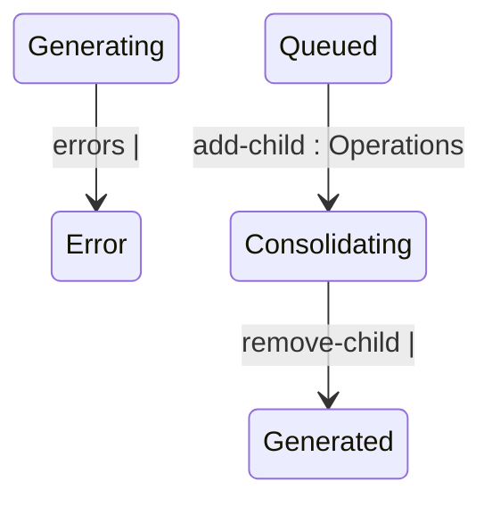

## Diagram

## States

<table>
  <thead>
    <tr>
      <th>State</th>
      <th>Description</th>
      <th>Initial State?</th>
      <th>Terminal State?</th>
    </tr>
  </thead>
  <tbody>
    <tr>
      <td>Generated</td>
      <td>The Statement has been created (or re-enriched) and is awaiting queueing.</td>
      <td>Yes</td>
      <td>No</td>
    </tr>
    <tr>
      <td>Cancelled</td>
      <td>Excluded from billing. Reached either directly at creation (a blocked billing pairing) or by an explicit `cancel`.</td>
      <td>Yes</td>
      <td>Yes</td>
    </tr>
    <tr>
      <td>Queued</td>
      <td>Queued for ERP integration; also the required status for a standalone Statement to be added as a child of a Consolidated parent.</td>
      <td>No</td>
      <td>No</td>
    </tr>
    <tr>
      <td>Pending</td>
      <td>Awaiting further ERP-side processing after being queued.</td>
      <td>No</td>
      <td>No</td>
    </tr>
    <tr>
      <td>Issued</td>
      <td>Sent to the Client.</td>
      <td>No</td>
      <td>Yes</td>
    </tr>
    <tr>
      <td>Error</td>
      <td>A processing failure requiring attention; billing is blocked until recovered.</td>
      <td>No</td>
      <td>No</td>
    </tr>
    <tr>
      <td>Generating</td>
      <td>An Automated Statement&#39;s charges are being re-enriched following a `recalculate`. Transient.</td>
      <td>No</td>
      <td>No</td>
    </tr>
    <tr>
      <td>Consolidating</td>
      <td>A standalone Statement currently linked as a child of a Consolidated parent, pending the parent&#39;s own queueing.</td>
      <td>No</td>
      <td>No</td>
    </tr>
    <tr>
      <td>Consolidated</td>
      <td>A child Statement whose Consolidated parent has been queued; rolled into the parent&#39;s single ERP posting.</td>
      <td>No</td>
      <td>No</td>
    </tr>
  </tbody>
</table>

## Transitions

<table>
  <thead>
    <tr>
      <th>ID</th>
      <th>To State</th>
      <th>Endpoint / Verb</th>
    </tr>
  </thead>
  <tbody>
    <tr>
      <td>T1</td>
      <td>Generated</td>
      <td>No dedicated endpoint — automatic on [[Ledger]] acceptance (Automated) or Custom Ledger acceptance (Manual); or `POST /statements` (Consolidated only)</td>
    </tr>
    <tr>
      <td>T2</td>
      <td>Cancelled</td>
      <td>No dedicated endpoint — automatic on Ledger/Custom Ledger acceptance</td>
    </tr>
    <tr>
      <td>T3</td>
      <td>Queued</td>
      <td>`POST /statements/{id}/queue`</td>
    </tr>
    <tr>
      <td>T4</td>
      <td>Queued</td>
      <td>`POST .../queue`; `POST .../retry`; or `POST .../recalculate` (Manual only)</td>
    </tr>
    <tr>
      <td>T5</td>
      <td>Pending</td>
      <td>`POST .../pending`</td>
    </tr>
    <tr>
      <td>T6</td>
      <td>Issued</td>
      <td>`POST .../issue`</td>
    </tr>
    <tr>
      <td>T7</td>
      <td>Error</td>
      <td>`POST .../error`</td>
    </tr>
    <tr>
      <td>T8</td>
      <td>Error</td>
      <td>`POST .../error`</td>
    </tr>
    <tr>
      <td>T9</td>
      <td>Cancelled</td>
      <td>`POST .../cancel`</td>
    </tr>
    <tr>
      <td>T10</td>
      <td>Cancelled</td>
      <td>`POST .../cancel`</td>
    </tr>
    <tr>
      <td>T11</td>
      <td>Cancelled</td>
      <td>`POST .../cancel`</td>
    </tr>
    <tr>
      <td>T12</td>
      <td>Cancelled</td>
      <td>`POST .../cancel`</td>
    </tr>
    <tr>
      <td>T13</td>
      <td>Generating</td>
      <td>`POST .../recalculate`</td>
    </tr>
    <tr>
      <td>T14</td>
      <td>Queued</td>
      <td>System (automatic)</td>
    </tr>
    <tr>
      <td>T15</td>
      <td>Error</td>
      <td>System (automatic)</td>
    </tr>
    <tr>
      <td>T16</td>
      <td>Consolidating</td>
      <td>`POST /statements/{id}/children` (called on the Consolidated parent)</td>
    </tr>
    <tr>
      <td>T17</td>
      <td>Generated</td>
      <td>`DELETE /statements/{id}/children/{childId}` (called on the Consolidated parent)</td>
    </tr>
    <tr>
      <td>T18</td>
      <td>Consolidated</td>
      <td>`POST /statements/{id}/queue`</td>
    </tr>
    <tr>
      <td>T19</td>
      <td>Queued</td>
      <td>`POST /statements/{id}/cancel`</td>
    </tr>
    <tr>
      <td>T20</td>
      <td>Queued</td>
      <td>`POST /statements/{id}/cancel`</td>
    </tr>
  </tbody>
</table>

