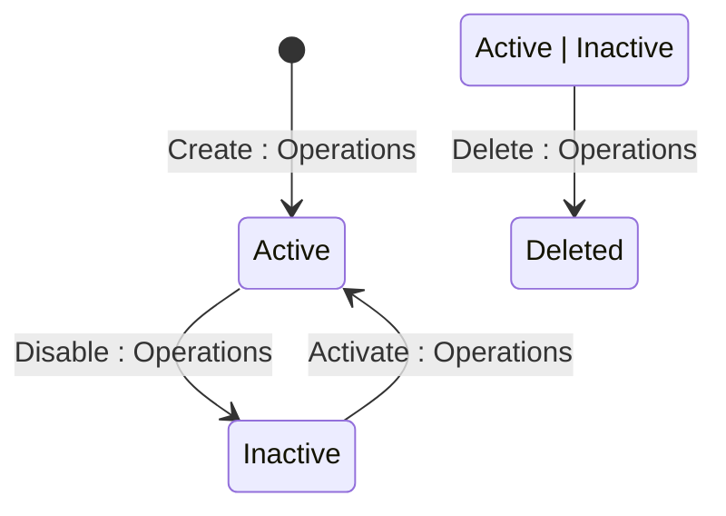

## State diagram

| State | Description | Initial State? | Terminal State? |
| --- | --- | --- | --- |

| Active | Policy is active and its yield cap is observed during Order pricing. A Pricing Policy is created directly in this state. | Yes | No |

| Inactive | Policy has been disabled. Yield cap is no longer observed on newly-priced Order lines. | No | No |

| Deleted | Policy has been soft-deleted. Remains fully retrievable via the API including in standard list responses. | No | Yes |

