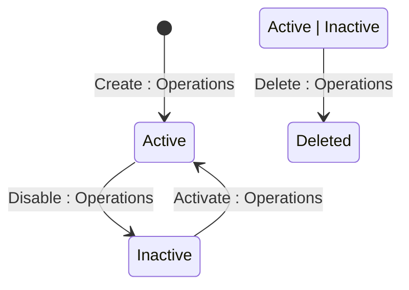

The Marketplace Platform provides three distinct user interfaces, namely the Client Portal, Vendor Portal, and Operations Portal. This topic describes how the account object transitions through different lifecycle states within the platform.


The diagrams show different transitions depending on whether the account is a Client/Partner or a Vendor, but the underlying statuses are the same.


## Diagram

## States

<table>
  <thead>
    <tr>
      <th>State</th>
      <th>Description</th>
      <th>Initial State?</th>
      <th>Terminal State?</th>
    </tr>
  </thead>
  <tbody>
    <tr>
      <td>Active</td>
      <td>Policy is active and its yield cap is observed during Order pricing. A Pricing Policy is created directly in this state.</td>
      <td>Yes</td>
      <td>No</td>
    </tr>
    <tr>
      <td>Inactive</td>
      <td>Policy has been disabled. Yield cap is no longer observed on newly-priced Order lines.</td>
      <td>No</td>
      <td>No</td>
    </tr>
    <tr>
      <td>Deleted</td>
      <td>Policy has been soft-deleted. Remains fully retrievable via the API including in standard list responses.</td>
      <td>No</td>
      <td>Yes</td>
    </tr>
  </tbody>
</table>

## Transitions

<table>
  <thead>
    <tr>
      <th>From State</th>
      <th>To State</th>
      <th>Action</th>
      <th>Endpoint / Verb</th>
      <th>Actor</th>
    </tr>
  </thead>
  <tbody>
    <tr>
      <td>—</td>
      <td>Active</td>
      <td>Create Pricing Policy</td>
      <td>`POST` (base collection endpoint)</td>
      <td>Operations</td>
    </tr>
    <tr>
      <td>Inactive</td>
      <td>Active</td>
      <td>Activate Pricing Policy</td>
      <td>`activate` (`POST .../activate`)</td>
      <td>Operations</td>
    </tr>
    <tr>
      <td>Active</td>
      <td>Inactive</td>
      <td>Disable Pricing Policy</td>
      <td>`disable` (`POST .../disable`)</td>
      <td>Operations</td>
    </tr>
    <tr>
      <td>Active</td>
      <td>Deleted</td>
      <td>Delete Pricing Policy</td>
      <td>`DELETE`</td>
      <td>Operations</td>
    </tr>
    <tr>
      <td>Inactive</td>
      <td>Deleted</td>
      <td>Delete Pricing Policy</td>
      <td>`DELETE`</td>
      <td>Operations</td>
    </tr>
  </tbody>
</table>

