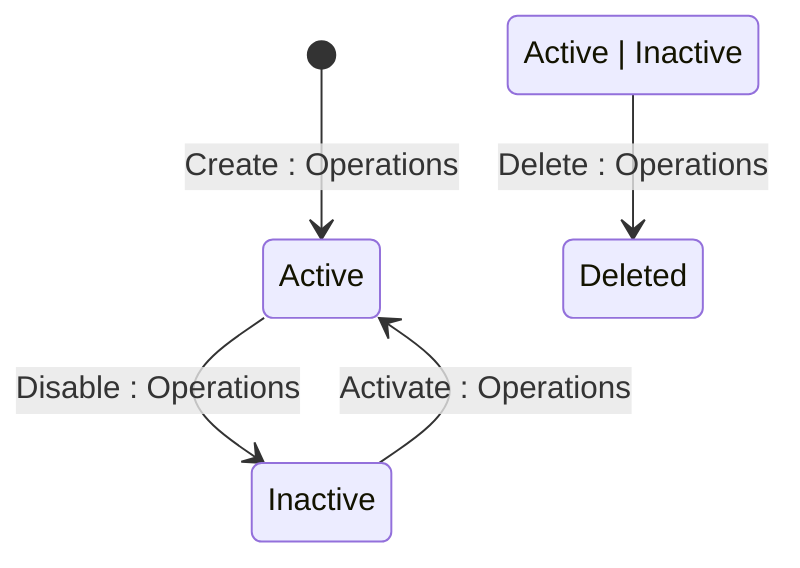

## State diagram

<table>
  <thead>
    <tr>

      <th>State</th>

      <th>Description</th>

      <th>Initial State?</th>

      <th>Terminal State?</th>

    </tr>
  </thead>
  <tbody>

    <tr>

      <td>Active</td>

      <td>Policy is active and its yield cap is observed during Order pricing. A Pricing Policy is created directly in this state.</td>

      <td>Yes</td>

      <td>No</td>

    </tr>

    <tr>

      <td>Inactive</td>

      <td>Policy has been disabled. Yield cap is no longer observed on newly-priced Order lines.</td>

      <td>No</td>

      <td>No</td>

    </tr>

    <tr>

      <td>Deleted</td>

      <td>Policy has been soft-deleted. Remains fully retrievable via the API including in standard list responses.</td>

      <td>No</td>

      <td>Yes</td>

    </tr>

  </tbody>
</table>

