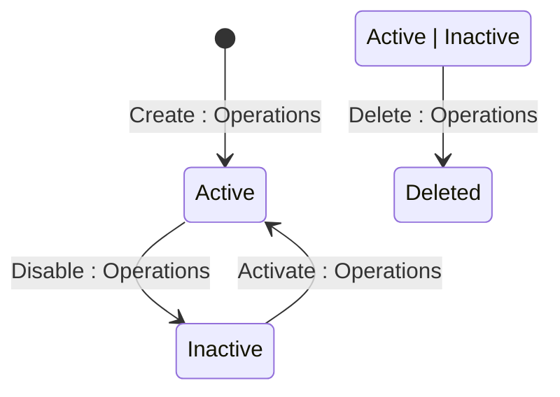

## State diagram

## States

<table>
  <thead>
    <tr>
      <th>State</th>
      <th>Description</th>
      <th>Initial State?</th>
      <th>Terminal State?</th>
    </tr>
  </thead>
  <tbody>
    <tr>
      <td>Active</td>
      <td>Policy is active and its yield cap is observed during Order pricing. A Pricing Policy is created directly in this state.</td>
      <td>Yes</td>
      <td>No</td>
    </tr>
    <tr>
      <td>Inactive</td>
      <td>Policy has been disabled. Yield cap is no longer observed on newly-priced Order lines.</td>
      <td>No</td>
      <td>No</td>
    </tr>
    <tr>
      <td>Deleted</td>
      <td>Policy has been soft-deleted. Remains fully retrievable via the API including in standard list responses.</td>
      <td>No</td>
      <td>Yes</td>
    </tr>
  </tbody>
</table>

## Transitions

<table>
  <thead>
    <tr>
      <th>ID</th>
      <th>From State</th>
      <th>To State</th>
      <th>Action</th>
      <th>Endpoint / Verb</th>
      <th>Actor</th>
      <th>Precondition</th>
      <th>Notes</th>
    </tr>
  </thead>
  <tbody>
    <tr>
      <td>T1</td>
      <td>—</td>
      <td>Active</td>
      <td>Create Pricing Policy</td>
      <td>`POST` (base collection endpoint)</td>
      <td>Operations</td>
      <td>Client Account must exist and be of type Client; no existing Active policy occupies the same Client + eligibility (+ Product) slot (BR-010).</td>
      <td>Policy is enforced immediately on creation.</td>
    </tr>
    <tr>
      <td>T2</td>
      <td>Inactive</td>
      <td>Active</td>
      <td>Activate Pricing Policy</td>
      <td>`activate` (`POST .../activate`)</td>
      <td>Operations</td>
      <td>Policy is Inactive; the same uniqueness check as creation is re-applied.</td>
      <td>Yield cap resumes on newly-priced matching lines.</td>
    </tr>
    <tr>
      <td>T3</td>
      <td>Active</td>
      <td>Inactive</td>
      <td>Disable Pricing Policy</td>
      <td>`disable` (`POST .../disable`)</td>
      <td>Operations</td>
      <td>Policy is Active.</td>
      <td>Yield cap no longer observed on newly-priced lines. Not blocked by any Orders governed by the policy.</td>
    </tr>
    <tr>
      <td>T4a</td>
      <td>Active</td>
      <td>Deleted</td>
      <td>Delete Pricing Policy</td>
      <td>`DELETE`</td>
      <td>Operations</td>
      <td>Policy is not already Deleted.</td>
      <td>Soft delete. Policy remains retrievable via the API. Not blocked by any Orders governed by the policy.</td>
    </tr>
    <tr>
      <td>T4b</td>
      <td>Inactive</td>
      <td>Deleted</td>
      <td>Delete Pricing Policy</td>
      <td>`DELETE`</td>
      <td>Operations</td>
      <td>Policy is not already Deleted.</td>
      <td>Soft delete. Policy remains retrievable via the API. Not blocked by any Orders governed by the policy.</td>
    </tr>
  </tbody>
</table>

