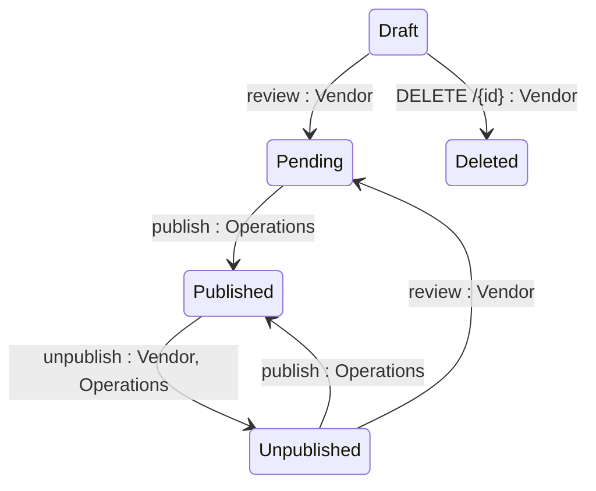

## State diagram

## States

<table>
  <thead>
    <tr>
      <th>State</th>
      <th>Description</th>
      <th>Initial State?</th>
      <th>Terminal State?</th>
    </tr>
  </thead>
  <tbody>
    <tr>
      <td>Draft</td>
      <td>Product is being authored by the Vendor. Visible to Operations but not to Clients. The only state from which deletion is permitted (T7).</td>
      <td>Yes</td>
      <td>No</td>
    </tr>
    <tr>
      <td>Pending</td>
      <td>Product has been submitted for publication review. Visible to Operations. Vendor cannot withdraw.</td>
      <td>No</td>
      <td>No</td>
    </tr>
    <tr>
      <td>Published</td>
      <td>Product is live on the Marketplace. Visible and purchasable by Clients.</td>
      <td>No</td>
      <td>No</td>
    </tr>
    <tr>
      <td>Unpublished</td>
      <td>Product has been removed from the Marketplace. Not discoverable or purchasable by new Clients. Existing-Agreement Clients retain transactional access. Can be returned to Pending for re-review (T6).</td>
      <td>No</td>
      <td>No</td>
    </tr>
    <tr>
      <td>Deleted</td>
      <td>Product has been soft-deleted, along with its child objects (see BR-002, Section 8). No longer retrievable via the API in any context.</td>
      <td>No</td>
      <td>Yes</td>
    </tr>
  </tbody>
</table>

## Transitions

<table>
  <thead>
    <tr>
      <th>ID</th>
      <th>From State</th>
      <th>To State</th>
      <th>Action</th>
      <th>Endpoint / Verb</th>
      <th>Actor</th>
      <th>Precondition</th>
      <th>Notes</th>
    </tr>
  </thead>
  <tbody>
    <tr>
      <td>T1</td>
      <td>—</td>
      <td>Draft</td>
      <td>Create Product</td>
      <td>`POST` (base collection endpoint)</td>
      <td>Vendor</td>
      <td>Name, icon, and website are required. No other preconditions.</td>
      <td>Product created in Draft state.</td>
    </tr>
    <tr>
      <td>T2</td>
      <td>Draft</td>
      <td>Pending</td>
      <td>Submit Product for Publication</td>
      <td>`review` (`POST .../{id}/review`)</td>
      <td>Vendor</td>
      <td>None — no completeness requirements. A Product with no child objects can be submitted.</td>
      <td>Product enters review queue. Vendor cannot reverse this transition (BR-004).</td>
    </tr>
    <tr>
      <td>T3</td>
      <td>Pending</td>
      <td>Published</td>
      <td>Publish Product</td>
      <td>`publish` (`POST .../{id}/publish`)</td>
      <td>Operations</td>
      <td>None enforced by the platform (BR-010)</td>
      <td>Product becomes visible and purchasable by Clients.</td>
    </tr>
    <tr>
      <td>T4</td>
      <td>Published</td>
      <td>Unpublished</td>
      <td>Unpublish Product</td>
      <td>`unpublish` (`POST .../{id}/unpublish`)</td>
      <td>Vendor, Operations</td>
      <td>None</td>
      <td>Product removed from Client discovery. Existing Agreements unaffected.</td>
    </tr>
    <tr>
      <td>T5</td>
      <td>Unpublished</td>
      <td>Published</td>
      <td>Republish Product</td>
      <td>`publish` (same route as T3)</td>
      <td>Operations</td>
      <td>None enforced by the platform (BR-010)</td>
      <td>Product restored to Client discovery. Republish uses the exact same Operations-only action as the original Publish, not a separate Vendor-accessible one.</td>
    </tr>
    <tr>
      <td>T6</td>
      <td>Unpublished</td>
      <td>Pending</td>
      <td>Review Product</td>
      <td>`review` (same route as T2)</td>
      <td>Vendor</td>
      <td>None found</td>
      <td>The same action handles both `Draft -&gt; Pending` and `Unpublished -&gt; Pending`; no state guard prevents this path. Lets a Vendor pull an Unpublished Product back into the review queue rather than only re-publishing it directly.</td>
    </tr>
    <tr>
      <td>T7</td>
      <td>Draft</td>
      <td>Deleted</td>
      <td>Delete Product</td>
      <td>`DELETE /{id}`</td>
      <td>Vendor</td>
      <td>Product must be in Draft state; the platform rejects the request otherwise.</td>
      <td>Soft delete; cascades to child objects and removes Documents/Media/Icon — see Section 6 and Section 8. Permanently removed — no longer retrievable via the API.</td>
    </tr>
  </tbody>
</table>

