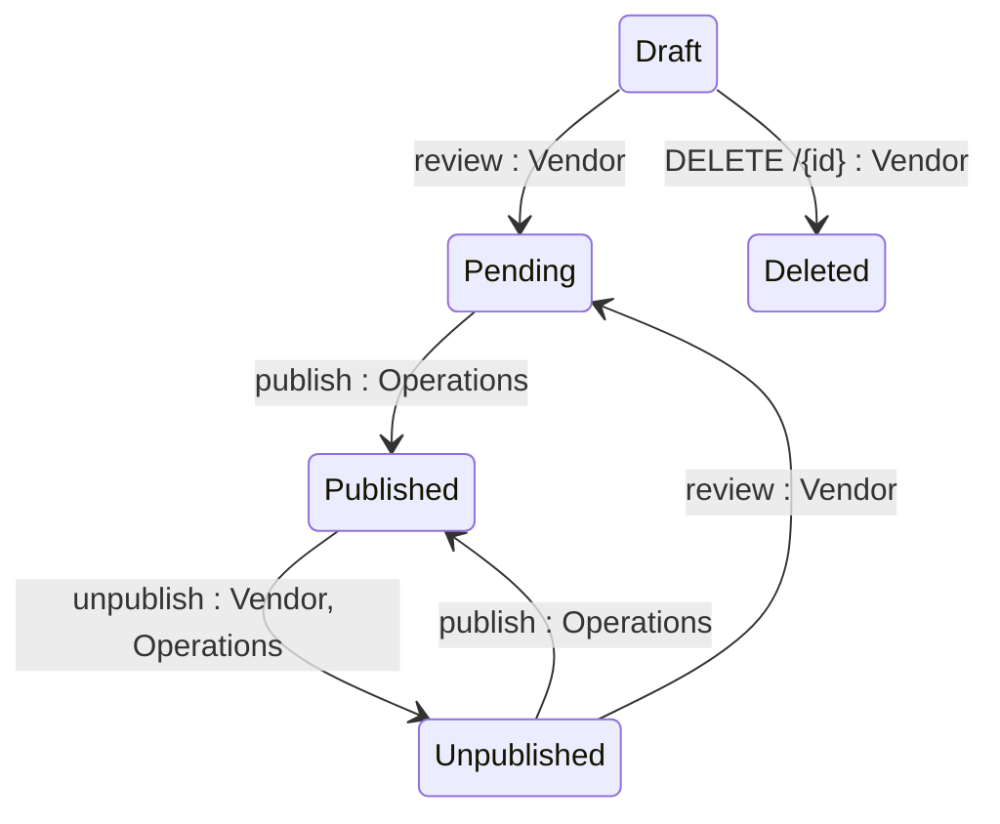

## Diagram

## States

<table>
  <thead>
    <tr>
      <th>State</th>
      <th>Description</th>
      <th>Initial State?</th>
      <th>Terminal State?</th>
    </tr>
  </thead>
  <tbody>
    <tr>
      <td>Draft</td>
      <td>Product is being authored by the Vendor. Visible to Operations but not to Clients. The only state from which deletion is permitted (T7).</td>
      <td>Yes</td>
      <td>No</td>
    </tr>
    <tr>
      <td>Pending</td>
      <td>Product has been submitted for publication review. Visible to Operations. Vendor cannot withdraw.</td>
      <td>No</td>
      <td>No</td>
    </tr>
    <tr>
      <td>Published</td>
      <td>Product is live on the Marketplace. Visible and purchasable by Clients.</td>
      <td>No</td>
      <td>No</td>
    </tr>
    <tr>
      <td>Unpublished</td>
      <td>Product has been removed from the Marketplace. Not discoverable or purchasable by new Clients. Existing-Agreement Clients retain transactional access. Can be returned to Pending for re-review (T6).</td>
      <td>No</td>
      <td>No</td>
    </tr>
    <tr>
      <td>Deleted</td>
      <td>Product has been soft-deleted, along with its child objects (see BR-002, Section 8). No longer retrievable via the API in any context.</td>
      <td>No</td>
      <td>Yes</td>
    </tr>
  </tbody>
</table>

## Transitions

<table>
  <thead>
    <tr>
      <th>From State</th>
      <th>To State</th>
      <th>Action</th>
      <th>Endpoint / Verb</th>
      <th>Actor</th>
    </tr>
  </thead>
  <tbody>
    <tr>
      <td>—</td>
      <td>Draft</td>
      <td>Create Product</td>
      <td>`POST` (base collection endpoint)</td>
      <td>Vendor</td>
    </tr>
    <tr>
      <td>Draft</td>
      <td>Pending</td>
      <td>Submit Product for Publication</td>
      <td>`review` (`POST .../{id}/review`)</td>
      <td>Vendor</td>
    </tr>
    <tr>
      <td>Pending</td>
      <td>Published</td>
      <td>Publish Product</td>
      <td>`publish` (`POST .../{id}/publish`)</td>
      <td>Operations</td>
    </tr>
    <tr>
      <td>Published</td>
      <td>Unpublished</td>
      <td>Unpublish Product</td>
      <td>`unpublish` (`POST .../{id}/unpublish`)</td>
      <td>Vendor, Operations</td>
    </tr>
    <tr>
      <td>Unpublished</td>
      <td>Published</td>
      <td>Republish Product</td>
      <td>`publish` (same route as T3)</td>
      <td>Operations</td>
    </tr>
    <tr>
      <td>Unpublished</td>
      <td>Pending</td>
      <td>Review Product</td>
      <td>`review` (same route as T2)</td>
      <td>Vendor</td>
    </tr>
    <tr>
      <td>Draft</td>
      <td>Deleted</td>
      <td>Delete Product</td>
      <td>`DELETE /{id}`</td>
      <td>Vendor</td>
    </tr>
  </tbody>
</table>

