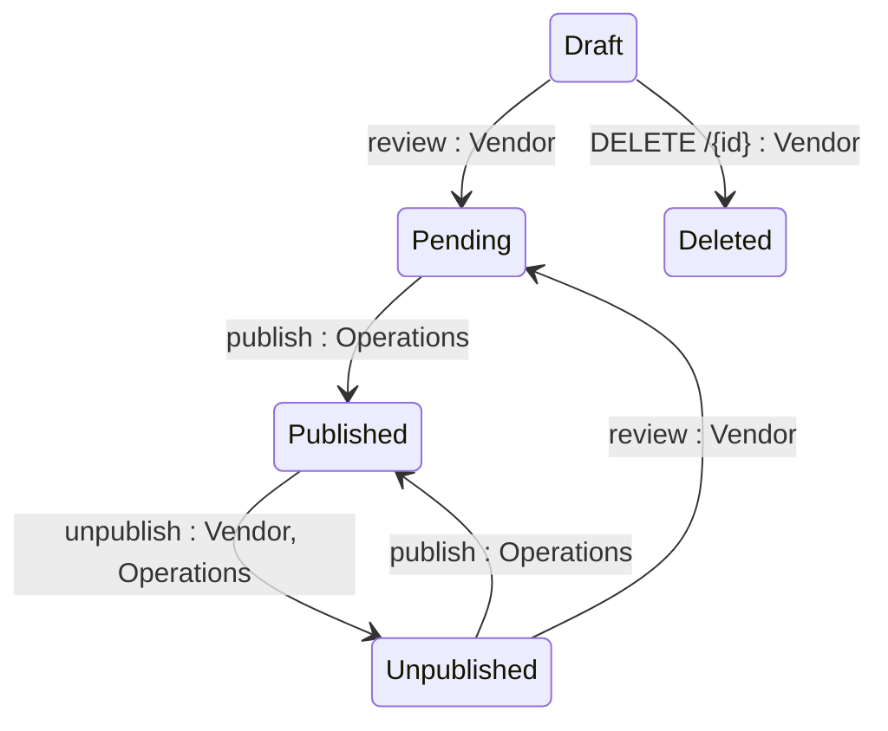

## State diagram

| State | Description | Initial State? | Terminal State? |
| --- | --- | --- | --- |

| Draft | Product is being authored by the Vendor. Visible to Operations but not to Clients. The only state from which deletion is permitted (T7). | Yes | No |

| Pending | Product has been submitted for publication review. Visible to Operations. Vendor cannot withdraw. | No | No |

| Published | Product is live on the Marketplace. Visible and purchasable by Clients. | No | No |

| Unpublished | Product has been removed from the Marketplace. Not discoverable or purchasable by new Clients. Existing-Agreement Clients retain transactional access. Can be returned to Pending for re-review (T6). | No | No |

| Deleted | Product has been soft-deleted, along with its child objects (see BR-002, Section 8). No longer retrievable via the API in any context. | No | Yes |

