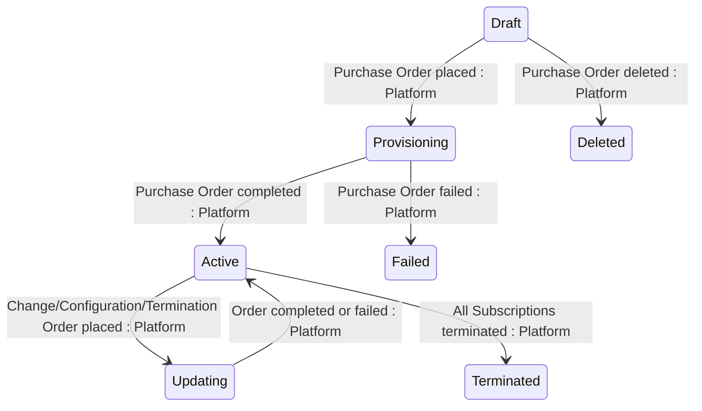

## State diagram

## States

<table>
  <thead>
    <tr>
      <th>State</th>
      <th>Description</th>
      <th>Initial State?</th>
      <th>Terminal State?</th>
    </tr>
  </thead>
  <tbody>
    <tr>
      <td>Draft</td>
      <td>The Agreement has been co-created with a Purchase Order that has not yet been placed. It has no active Subscriptions or Assets, and no parameters yet.</td>
      <td>Yes (co-creation)</td>
      <td>No</td>
    </tr>
    <tr>
      <td>Provisioning</td>
      <td>The Purchase Order against this Agreement has been placed and is being processed by the Vendor.</td>
      <td>No</td>
      <td>No</td>
    </tr>
    <tr>
      <td>Updating</td>
      <td>A Change, Configuration, Termination, Suspend, or Resume Order against this Agreement has been placed and is being processed.</td>
      <td>No</td>
      <td>No</td>
    </tr>
    <tr>
      <td>Active</td>
      <td>The Agreement is active with at least one live Subscription or Asset. It returns to Active when a Change, Configuration, or Termination Order completes or fails.</td>
      <td>Yes (Operations direct create)</td>
      <td>No</td>
    </tr>
    <tr>
      <td>Terminated</td>
      <td>Every Subscription on the Agreement is Terminated or Expired. Terminal — no outbound transitions.</td>
      <td>Yes (Operations direct create)</td>
      <td>Yes</td>
    </tr>
    <tr>
      <td>Failed</td>
      <td>The Purchase Order against this Agreement failed. The Agreement cannot be transacted against and cannot be recovered. Terminal — no outbound transitions.</td>
      <td>No</td>
      <td>Yes</td>
    </tr>
    <tr>
      <td>Deleted</td>
      <td>The Agreement has been soft-deleted — moves to Deleted status and remains retrievable via the API including in standard list responses. Only reachable from Draft when the co-created Purchase Order is deleted. Terminal — no outbound transitions. Deviates from Platform Invariant 7.</td>
      <td>No</td>
      <td>Yes</td>
    </tr>
  </tbody>
</table>

