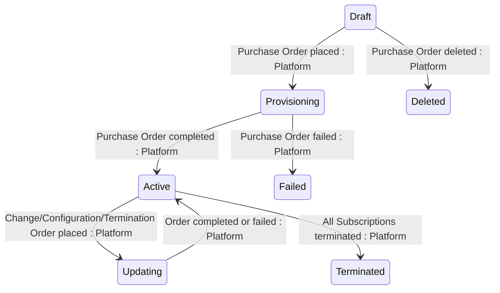

## State diagram

| State | Description | Initial State? | Terminal State? |
| --- | --- | --- | --- |

| Draft | The Agreement has been co-created with a Purchase Order that has not yet been placed. It has no active Subscriptions or Assets, and no parameters yet. | Yes (co-creation) | No |

| Provisioning | The Purchase Order against this Agreement has been placed and is being processed by the Vendor. | No | No |

| Updating | A Change, Configuration, Termination, Suspend, or Resume Order against this Agreement has been placed and is being processed. | No | No |

| Active | The Agreement is active with at least one live Subscription or Asset. It returns to Active when a Change, Configuration, or Termination Order completes or fails. | Yes (Operations direct create) | No |

| Terminated | Every Subscription on the Agreement is Terminated or Expired. Terminal — no outbound transitions. | Yes (Operations direct create) | Yes |

| Failed | The Purchase Order against this Agreement failed. The Agreement cannot be transacted against and cannot be recovered. Terminal — no outbound transitions. | No | Yes |

| Deleted | The Agreement has been soft-deleted — moves to Deleted status and remains retrievable via the API including in standard list responses. Only reachable from Draft when the co-created Purchase Order is deleted. Terminal — no outbound transitions. Deviates from Platform Invariant 7. | No | Yes |

