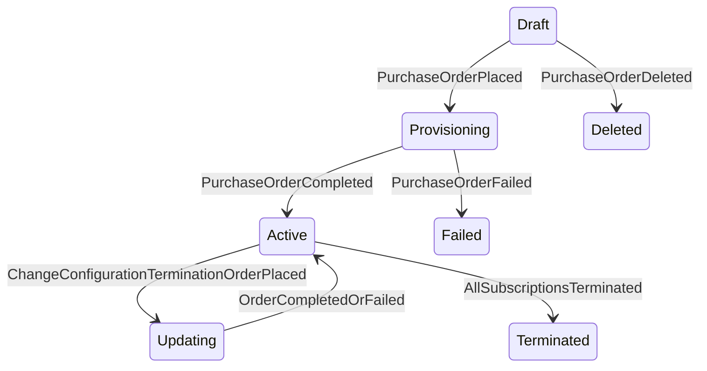

The Marketplace Platform provides three distinct user interfaces, namely the Client Portal, Vendor Portal, and Operations Portal. This topic describes how the account object transitions through different lifecycle states within the platform.


The diagrams show different transitions depending on whether the account is a Client/Partner or a Vendor, but the underlying statuses are the same.


## Diagram

## States

<table>
  <thead>
    <tr>
      <th>State</th>
      <th>Description</th>
      <th>Initial State?</th>
      <th>Terminal State?</th>
    </tr>
  </thead>
  <tbody>
    <tr>
      <td>Draft</td>
      <td>The Agreement has been co-created with a Purchase Order that has not yet been placed. It has no active Subscriptions or Assets, and no parameters yet.</td>
      <td>Yes (co-creation)</td>
      <td>No</td>
    </tr>
    <tr>
      <td>Provisioning</td>
      <td>The Purchase Order against this Agreement has been placed and is being processed by the Vendor.</td>
      <td>No</td>
      <td>No</td>
    </tr>
    <tr>
      <td>Updating</td>
      <td>A Change, Configuration, Termination, Suspend, or Resume Order against this Agreement has been placed and is being processed.</td>
      <td>No</td>
      <td>No</td>
    </tr>
    <tr>
      <td>Active</td>
      <td>The Agreement is active with at least one live Subscription or Asset. It returns to Active when a Change, Configuration, or Termination Order completes or fails.</td>
      <td>Yes (Operations direct create)</td>
      <td>No</td>
    </tr>
    <tr>
      <td>Terminated</td>
      <td>Every Subscription on the Agreement is Terminated or Expired. Terminal — no outbound transitions.</td>
      <td>Yes (Operations direct create)</td>
      <td>Yes</td>
    </tr>
    <tr>
      <td>Failed</td>
      <td>The Purchase Order against this Agreement failed. The Agreement cannot be transacted against and cannot be recovered. Terminal — no outbound transitions.</td>
      <td>No</td>
      <td>Yes</td>
    </tr>
    <tr>
      <td>Deleted</td>
      <td>The Agreement has been soft-deleted — moves to Deleted status and remains retrievable via the API including in standard list responses. Only reachable from Draft when the co-created Purchase Order is deleted. Terminal — no outbound transitions. Deviates from Platform Invariant 7.</td>
      <td>No</td>
      <td>Yes</td>
    </tr>
  </tbody>
</table>

## Transitions

<table>
  <thead>
    <tr>
      <th>From State</th>
      <th>To State</th>
      <th>Action</th>
      <th>Endpoint / Verb</th>
      <th>Actor</th>
    </tr>
  </thead>
  <tbody>
    <tr>
      <td>—</td>
      <td>Draft</td>
      <td>Co-created with Purchase Order</td>
      <td>(no dedicated Agreement endpoint — co-created when a Purchase Order is persisted via `POST /commerce/orders`)</td>
      <td>Platform (Client token)</td>
    </tr>
    <tr>
      <td>—</td>
      <td>Provisioning</td>
      <td>Co-created and placed in one call</td>
      <td>(no dedicated Agreement endpoint — Purchase Order created directly in Processing)</td>
      <td>Platform (Client token)</td>
    </tr>
    <tr>
      <td>—</td>
      <td>Active</td>
      <td>Operations direct create</td>
      <td>`POST /commerce/agreements`</td>
      <td>Operations</td>
    </tr>
    <tr>
      <td>—</td>
      <td>Terminated</td>
      <td>Operations direct create (terminated)</td>
      <td>`POST /commerce/agreements`</td>
      <td>Operations</td>
    </tr>
    <tr>
      <td>Draft</td>
      <td>Provisioning</td>
      <td>Purchase Order placed</td>
      <td>(no dedicated Agreement endpoint — Purchase Order → Processing)</td>
      <td>Platform (Client token)</td>
    </tr>
    <tr>
      <td>Draft</td>
      <td>Deleted</td>
      <td>Purchase Order deleted</td>
      <td>(no dedicated Agreement endpoint — Draft/Quoted Purchase Order deleted)</td>
      <td>Platform (deleting Actor&#39;s token)</td>
    </tr>
    <tr>
      <td>Provisioning</td>
      <td>Active</td>
      <td>Purchase Order completed</td>
      <td>(no dedicated Agreement endpoint — Purchase Order → Completed)</td>
      <td>Platform (Vendor token)</td>
    </tr>
    <tr>
      <td>Provisioning</td>
      <td>Failed</td>
      <td>Purchase Order failed</td>
      <td>(no dedicated Agreement endpoint — Purchase Order → Failed)</td>
      <td>Platform (Vendor or Operations token)</td>
    </tr>
    <tr>
      <td>Active</td>
      <td>Updating</td>
      <td>Change, Configuration, Termination, Suspend, or Resume Order placed</td>
      <td>(no dedicated Agreement endpoint — non-Purchase Order → Processing)</td>
      <td>Platform (Client token)</td>
    </tr>
    <tr>
      <td>Updating</td>
      <td>Active</td>
      <td>Order completed, or non-Purchase Order failed</td>
      <td>(no dedicated Agreement endpoint — Order → Completed/Failed)</td>
      <td>Platform (Vendor or Operations token)</td>
    </tr>
    <tr>
      <td>Active</td>
      <td>Terminated</td>
      <td>Final Subscription terminated</td>
      <td>(no dedicated Agreement endpoint — driven by Subscription state / Termination Order completion)</td>
      <td>Platform</td>
    </tr>
  </tbody>
</table>

