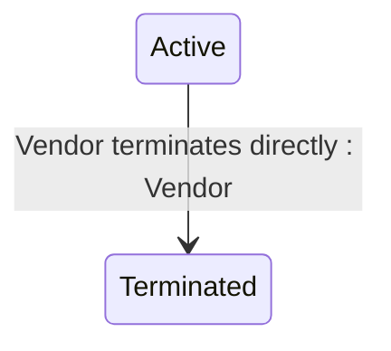

## State diagram

## States

<table>
  <thead>
    <tr>
      <th>State</th>
      <th>Description</th>
      <th>Initial State?</th>
      <th>Terminal State?</th>
    </tr>
  </thead>
  <tbody>
    <tr>
      <td>Draft</td>
      <td>The Asset exists only within the scope of a Processing Order as an OrderAsset. It is a temporary representation created by the Vendor during Order Processing. Accessible via `/orders/{id}/assets`. The Draft state is not visible on the live Asset — the live Asset is created directly in Active status when the Order completes.</td>
      <td>—</td>
      <td>—</td>
    </tr>
    <tr>
      <td>Active</td>
      <td>The Asset is live. The Vendor owns and maintains it. There is no renewal service — Active is the permanent state for a live Asset unless the Vendor terminates it.</td>
      <td>—</td>
      <td>—</td>
    </tr>
    <tr>
      <td>Terminated</td>
      <td>The Asset has been permanently ended by direct Vendor action via the terminate action. Terminal state — no outbound transitions.</td>
      <td>—</td>
      <td>—</td>
    </tr>
  </tbody>
</table>

## Transitions

<table>
  <thead>
    <tr>
      <th>ID</th>
      <th>From State</th>
      <th>To State</th>
      <th>Action</th>
      <th>Endpoint / Verb</th>
      <th>Actor</th>
      <th>Precondition</th>
      <th>Notes</th>
    </tr>
  </thead>
  <tbody>
    <tr>
      <td>T1</td>
      <td>—</td>
      <td>Active</td>
      <td>Order completed — promoted from OrderAsset</td>
      <td>No dedicated Asset endpoint — a plain, platform-driven status write. The promotion happens automatically as part of the parent [[Order]]&#39;s own completion processing; there is no separate Asset-facing action to invoke it.</td>
      <td>Platform</td>
      <td>Purchase or Change Order transitions to Completed; the OrderAsset has at least one Line (an OrderAsset with no Lines is discarded, not promoted).</td>
      <td>Platform promotes the OrderAsset to a live Asset under Vendor token context. Same ID retained. Asset linked to Agreement simultaneously. Terms are set from the OrderAsset&#39;s own terms.</td>
    </tr>
    <tr>
      <td>T2</td>
      <td>—</td>
      <td>Active</td>
      <td>Vendor creates directly</td>
      <td>`POST` `/commerce/assets` (Vendor-only)</td>
      <td>Vendor</td>
      <td>Parent Agreement must be New, Draft, or Active. At least one Line must be supplied, each referencing a valid Item and a quantity of zero or greater.</td>
      <td>Used for migration scenarios or direct vendor sync. Asset created directly in Active status without an Order.</td>
    </tr>
    <tr>
      <td>T3</td>
      <td>Active</td>
      <td>Terminated</td>
      <td>Terminate Asset</td>
      <td>`POST` `/commerce/assets/{id}/terminate` (Vendor-only)</td>
      <td>Vendor</td>
      <td>Asset must be Active</td>
      <td>No effect on parent Agreement status (Agreement price is recalculated). Each of the Asset&#39;s still-Active Lines is also transitioned to Terminated with quantity set to zero.</td>
    </tr>
  </tbody>
</table>

