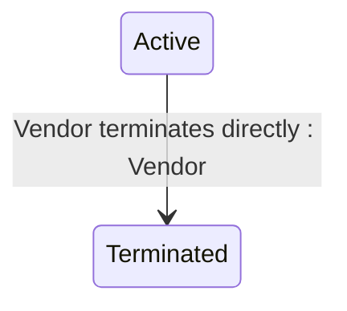

## State diagram

## States

<table>
  <thead>
    <tr>
      <th>State</th>
      <th>Description</th>
      <th>Initial State?</th>
      <th>Terminal State?</th>
    </tr>
  </thead>
  <tbody>
    <tr>
      <td>Draft</td>
      <td>The Asset exists only within the scope of a Processing Order as an OrderAsset. It is a temporary representation created by the Vendor during Order Processing. Accessible via `/orders/{id}/assets`. The Draft state is not visible on the live Asset — the live Asset is created directly in Active status when the Order completes.</td>
      <td>—</td>
      <td>—</td>
    </tr>
    <tr>
      <td>Active</td>
      <td>The Asset is live. The Vendor owns and maintains it. There is no renewal service — Active is the permanent state for a live Asset unless the Vendor terminates it.</td>
      <td>—</td>
      <td>—</td>
    </tr>
    <tr>
      <td>Terminated</td>
      <td>The Asset has been permanently ended by direct Vendor action via the terminate action. Terminal state — no outbound transitions.</td>
      <td>—</td>
      <td>—</td>
    </tr>
  </tbody>
</table>

