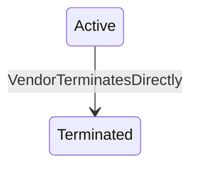

The Marketplace Platform provides three distinct user interfaces, namely the Client Portal, Vendor Portal, and Operations Portal. This topic describes how the account object transitions through different lifecycle states within the platform.


The diagrams show different transitions depending on whether the account is a Client/Partner or a Vendor, but the underlying statuses are the same.


## Diagram

## States

<table>
  <thead>
    <tr>
      <th>State</th>
      <th>Description</th>
      <th>Initial State?</th>
      <th>Terminal State?</th>
    </tr>
  </thead>
  <tbody>
    <tr>
      <td>Draft</td>
      <td>The Asset exists only within the scope of a Processing Order as an OrderAsset. It is a temporary representation created by the Vendor during Order Processing. Accessible via `/orders/{id}/assets`. The Draft state is not visible on the live Asset — the live Asset is created directly in Active status when the Order completes.</td>
      <td>—</td>
      <td>—</td>
    </tr>
    <tr>
      <td>Active</td>
      <td>The Asset is live. The Vendor owns and maintains it. There is no renewal service — Active is the permanent state for a live Asset unless the Vendor terminates it.</td>
      <td>—</td>
      <td>—</td>
    </tr>
    <tr>
      <td>Terminated</td>
      <td>The Asset has been permanently ended by direct Vendor action via the terminate action. Terminal state — no outbound transitions.</td>
      <td>—</td>
      <td>—</td>
    </tr>
  </tbody>
</table>

## Transitions

<table>
  <thead>
    <tr>
      <th>From State</th>
      <th>To State</th>
      <th>Action</th>
      <th>Endpoint / Verb</th>
      <th>Actor</th>
    </tr>
  </thead>
  <tbody>
    <tr>
      <td>—</td>
      <td>Active</td>
      <td>Order completed — promoted from OrderAsset</td>
      <td>No dedicated Asset endpoint — a plain, platform-driven status write. The promotion happens automatically as part of the parent [[Order]]&#39;s own completion processing; there is no separate Asset-facing action to invoke it.</td>
      <td>Platform</td>
    </tr>
    <tr>
      <td>—</td>
      <td>Active</td>
      <td>Vendor creates directly</td>
      <td>`POST` `/commerce/assets` (Vendor-only)</td>
      <td>Vendor</td>
    </tr>
    <tr>
      <td>Active</td>
      <td>Terminated</td>
      <td>Terminate Asset</td>
      <td>`POST` `/commerce/assets/{id}/terminate` (Vendor-only)</td>
      <td>Vendor</td>
    </tr>
  </tbody>
</table>

