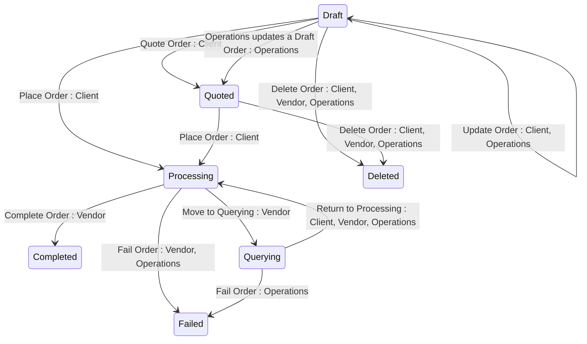

## State diagram

## States

<table>
  <thead>
    <tr>
      <th>State</th>
      <th>Description</th>
      <th>Initial State?</th>
      <th>Terminal State?</th>
    </tr>
  </thead>
  <tbody>
    <tr>
      <td>Draft</td>
      <td>The Order has been created and saved but not yet placed. The Client can edit ordering parameters. The Order has not yet been submitted for fulfilment.</td>
      <td>Yes</td>
      <td>—</td>
    </tr>
    <tr>
      <td>Quoted</td>
      <td>The Order has been marked as ready for Client placement. Functionally equivalent to Draft except that no parameter values can be edited. Signals to the Client that the Order is ready to be placed. Draft → Quoted is a one-way transition.</td>
      <td>Yes</td>
      <td>—</td>
    </tr>
    <tr>
      <td>Processing</td>
      <td>The Order has been placed by the Client and is being fulfilled by the Vendor. The Vendor can update ordering and fulfilment parameters and transition the Order to Querying, Completed, or Failed.</td>
      <td>Yes</td>
      <td>—</td>
    </tr>
    <tr>
      <td>Querying</td>
      <td>The Order has been paused by the Vendor pending Client action — either correction of invalid parameter values or completion of an external task. The Client can update ordering parameters. The Order must return to Processing before it can be Completed. It can be Failed directly, but only by Operations.</td>
      <td>—</td>
      <td>—</td>
    </tr>
    <tr>
      <td>Completed</td>
      <td>The Order has been successfully fulfilled. All Lines have been mapped to a Subscription or Asset. Terminal state — no outbound transitions.</td>
      <td>—</td>
      <td>Yes</td>
    </tr>
    <tr>
      <td>Failed</td>
      <td>The Order could not be fulfilled. A `statusNotes` object is present explaining the reason for failure. A new Order must be created to retry. Terminal state — no outbound transitions.</td>
      <td>—</td>
      <td>Yes</td>
    </tr>
    <tr>
      <td>Deleted</td>
      <td>The Order has been soft-deleted — it moves to Deleted status and remains retrievable via the API including in standard list responses. Only reachable from Draft or Quoted. Terminal state — no outbound transitions. Deviates from Platform Invariant 7 — see Section 8.</td>
      <td>—</td>
      <td>Yes</td>
    </tr>
  </tbody>
</table>

