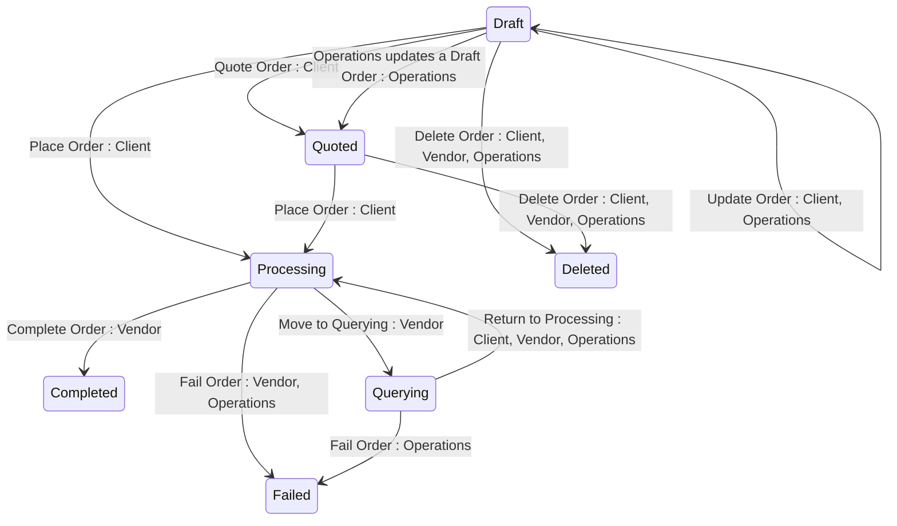

## State diagram

## States

<table>
  <thead>
    <tr>
      <th>State</th>
      <th>Description</th>
      <th>Initial State?</th>
      <th>Terminal State?</th>
    </tr>
  </thead>
  <tbody>
    <tr>
      <td>Draft</td>
      <td>The Order has been created and saved but not yet placed. The Client can edit ordering parameters. The Order has not yet been submitted for fulfilment.</td>
      <td>Yes</td>
      <td>—</td>
    </tr>
    <tr>
      <td>Quoted</td>
      <td>The Order has been marked as ready for Client placement. Functionally equivalent to Draft except that no parameter values can be edited. Signals to the Client that the Order is ready to be placed. Draft → Quoted is a one-way transition.</td>
      <td>Yes</td>
      <td>—</td>
    </tr>
    <tr>
      <td>Processing</td>
      <td>The Order has been placed by the Client and is being fulfilled by the Vendor. The Vendor can update ordering and fulfilment parameters and transition the Order to Querying, Completed, or Failed.</td>
      <td>Yes</td>
      <td>—</td>
    </tr>
    <tr>
      <td>Querying</td>
      <td>The Order has been paused by the Vendor pending Client action — either correction of invalid parameter values or completion of an external task. The Client can update ordering parameters. The Order must return to Processing before it can be Completed. It can be Failed directly, but only by Operations.</td>
      <td>—</td>
      <td>—</td>
    </tr>
    <tr>
      <td>Completed</td>
      <td>The Order has been successfully fulfilled. All Lines have been mapped to a Subscription or Asset. Terminal state — no outbound transitions.</td>
      <td>—</td>
      <td>Yes</td>
    </tr>
    <tr>
      <td>Failed</td>
      <td>The Order could not be fulfilled. A `statusNotes` object is present explaining the reason for failure. A new Order must be created to retry. Terminal state — no outbound transitions.</td>
      <td>—</td>
      <td>Yes</td>
    </tr>
    <tr>
      <td>Deleted</td>
      <td>The Order has been soft-deleted — it moves to Deleted status and remains retrievable via the API including in standard list responses. Only reachable from Draft or Quoted. Terminal state — no outbound transitions. Deviates from Platform Invariant 7 — see Section 8.</td>
      <td>—</td>
      <td>Yes</td>
    </tr>
  </tbody>
</table>

## Transitions

<table>
  <thead>
    <tr>
      <th>ID</th>
      <th>From State</th>
      <th>To State</th>
      <th>Action</th>
      <th>Endpoint / Verb</th>
      <th>Actor</th>
      <th>Precondition</th>
      <th>Notes</th>
    </tr>
  </thead>
  <tbody>
    <tr>
      <td>T1</td>
      <td>—</td>
      <td>Draft</td>
      <td>Create Order</td>
      <td>`POST` (base collection endpoint)</td>
      <td>Client</td>
      <td>Product must be Published. Listing must resolve for the Product and Licensee. Licensee must belong to the Client&#39;s Account. Parameter values must be valid.</td>
      <td>Platform simultaneously creates a corresponding Draft Agreement for Purchase Orders. For Change, Configuration, and Termination Orders, the Order is created against an existing Active Agreement.</td>
    </tr>
    <tr>
      <td>T2</td>
      <td>—</td>
      <td>Quoted</td>
      <td>Create Order as Quoted</td>
      <td>`POST` (base collection endpoint)</td>
      <td>Client</td>
      <td>Same as T1.</td>
      <td>Order created directly in Quoted status without passing through Draft.</td>
    </tr>
    <tr>
      <td>T3</td>
      <td>—</td>
      <td>Processing</td>
      <td>Create and place Order</td>
      <td>`POST` (base collection endpoint)</td>
      <td>Client</td>
      <td>Same as T1.</td>
      <td>Order created and placed in a single API call without persisting as Draft or Quoted. Coupled Agreement/Subscription/Asset transitions are the same as T6.</td>
    </tr>
    <tr>
      <td>T4</td>
      <td>Draft</td>
      <td>Draft</td>
      <td>Update Order</td>
      <td>`PUT` (`/{id}`)</td>
      <td>Client, Operations</td>
      <td>Order must be in Draft.</td>
      <td>Client can update `parameters.ordering`. Operations can update the Order.</td>
    </tr>
    <tr>
      <td>T5</td>
      <td>Draft</td>
      <td>Quoted</td>
      <td>Quote Order (two mechanisms)</td>
      <td>`/quote` (`POST`, Client) or `PUT` `/{id}` (Operations)</td>
      <td>Client, Operations</td>
      <td>Order must be in Draft.</td>
      <td>Two mechanisms reach Quoted: (a) the Client&#39;s explicit `/quote` call — the `/quote` endpoint is Client-only, rejecting Operations and the Vendor; and (b) a side effect of any Operations update to a Draft Order (e.g. adjusting an Order Line margin). A Vendor cannot move an Order to Quoted by any path. No parameter edits are permitted after this transition; Draft → Quoted is one-way.</td>
    </tr>
    <tr>
      <td>T6</td>
      <td>Draft</td>
      <td>Processing</td>
      <td>Place Order</td>
      <td>`/process` (`POST`)</td>
      <td>Client</td>
      <td>Order must have at least one Line (Purchase, Change, Termination). Parameter values are validated.</td>
      <td>Agreement → Provisioning (Purchase) or Updating (Change, Configuration, Termination). Affected pre-existing Subscriptions → Updating (Change), Terminating (Termination), Updating (Configuration). If ordering parameters are invalid, the Order is moved to Processing and then immediately to Querying rather than being rejected.</td>
    </tr>
    <tr>
      <td>T7</td>
      <td>Draft</td>
      <td>Deleted</td>
      <td>Delete Order</td>
      <td>`DELETE` (`/{id}`)</td>
      <td>Client, Vendor, Operations</td>
      <td>Order must be in Draft.</td>
      <td>Soft-deleted — moves to Deleted status, remains retrievable via the API. For Purchase Orders, the corresponding Draft Agreement is also moved to Deleted status.</td>
    </tr>
    <tr>
      <td>T8</td>
      <td>Quoted</td>
      <td>Processing</td>
      <td>Place Order</td>
      <td>`/process` (`POST`)</td>
      <td>Client</td>
      <td>Same as T6.</td>
      <td>Same coupled transitions and auto-query-on-invalid-parameters behaviour as T6.</td>
    </tr>
    <tr>
      <td>T9</td>
      <td>Quoted</td>
      <td>Deleted</td>
      <td>Delete Order</td>
      <td>`DELETE` (`/{id}`)</td>
      <td>Client, Vendor, Operations</td>
      <td>Order must be in Quoted.</td>
      <td>Same soft-delete behaviour as T7. For Purchase Orders, corresponding Draft Agreement also → Deleted.</td>
    </tr>
    <tr>
      <td>T10</td>
      <td>Processing</td>
      <td>Completed</td>
      <td>Complete Order</td>
      <td>`/complete` (`POST`)</td>
      <td>Vendor</td>
      <td>Every Line must be mapped to a Subscription or Asset (Purchase, Change, Termination). Fulfilment parameters must be valid.</td>
      <td>Completion is Vendor-only — the Client and Operations are rejected. Agreement → Active. Draft Subscriptions and Assets created during Processing → Active and linked to Agreement. For Termination Orders, terminated Subscriptions → Terminated; if all Subscriptions on the Agreement are Terminated, Agreement → Terminated. On completion of a Change or Termination Order, all other Draft and Quoted Orders on the Agreement → Deleted.</td>
    </tr>
    <tr>
      <td>T11</td>
      <td>Processing</td>
      <td>Failed</td>
      <td>Fail Order</td>
      <td>`/fail` (`POST`)</td>
      <td>Vendor, Operations</td>
      <td>`statusNotes` must contain a message.</td>
      <td>The Client cannot fail an Order. Purchase: Agreement → Failed. Change, Configuration, Termination: Agreement → Active, Subscriptions and Assets reverted.</td>
    </tr>
    <tr>
      <td>T12</td>
      <td>Processing</td>
      <td>Querying</td>
      <td>Move to Querying</td>
      <td>`/query` (`POST`)</td>
      <td>Vendor</td>
      <td>Agreement must not be Deleted, Failed, or Terminated.</td>
      <td>Moving an Order to Querying is Vendor-only — Operations and the Client are rejected.</td>
    </tr>
    <tr>
      <td>T13</td>
      <td>Querying</td>
      <td>Processing</td>
      <td>Return to Processing</td>
      <td>`/process` (`POST`)</td>
      <td>Client, Vendor, Operations</td>
      <td>Agreement must be in a status that permits processing.</td>
      <td>Client typically updates `parameters.ordering` before returning. If the Client returns the Order while parameters are still invalid, the platform rejects the return and the Order remains in Querying. A Vendor returning the Order bypasses the parameter-validity gate.</td>
    </tr>
    <tr>
      <td>T14</td>
      <td>Querying</td>
      <td>Failed</td>
      <td>Fail Order</td>
      <td>`/fail` (`POST`)</td>
      <td>Operations</td>
      <td>`statusNotes` must contain a message.</td>
      <td>Failing a Querying Order is Operations-only — the Vendor cannot fail an Order while it is Querying. Same Agreement effects as T11.</td>
    </tr>
  </tbody>
</table>

