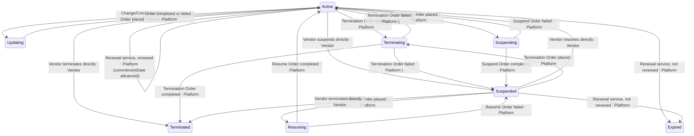

## State diagram

| State | Description | Initial State? | Terminal State? |
| --- | --- | --- | --- |

| Active | The Subscription is live and fulfilling. It is evaluated daily by the platform's renewal service and may be renewed, expired, suspended, updated, or terminated. | Yes | No |

| Updating | A Change or Configuration Order affecting this Subscription is being processed. The Subscription returns to Active when the Order completes or fails. | No | No |

| Terminating | A Termination Order affecting this Subscription is being processed. The Subscription transitions to Terminated when the Order completes, or reverts when it fails. | No | No |

| Suspending | A Suspend Order affecting this Subscription is being processed. The Subscription transitions to Suspended when the Order completes, or reverts to Active when it fails. | No | No |

| Suspended | Fulfilment is paused. The Subscription can be resumed, terminated, or expired. | No | No |

| Resuming | A Resume Order affecting this Subscription is being processed. The Subscription transitions to Active when the Order completes, or reverts to Suspended when it fails. | No | No |

| Terminated | The Subscription has been permanently ended — by a completed Termination Order or by direct Vendor action. Terminal — no outbound transitions. | No | Yes |

| Expired | The Subscription's `commitmentDate` passed without renewal and the platform's daily service moved it to Expired. Terminal — no outbound transitions. | No | Yes |

