The Marketplace Platform provides three distinct user interfaces, namely the Client Portal, Vendor Portal, and Operations Portal. This topic describes how the account object transitions through different lifecycle states within the platform.


The diagrams show different transitions depending on whether the account is a Client/Partner or a Vendor, but the underlying statuses are the same.


## Diagram

```mermaid
stateDiagram-v2
    Active --> Updating : ChangeConfigurationOrderPlaced
    Active --> Terminating : TerminationOrderPlaced
    Active --> Suspended : VendorSuspendsDirectly
    Active --> Suspending : SuspendOrderPlaced
    Active --> Expired : RenewalServiceNotRenewed
    Active --> Active : RenewalServiceRenewed
    Active --> Terminated : VendorTerminatesDirectly
    Updating --> Active : OrderCompletedOrFailed
    Terminating --> Terminated : TerminationOrderCompleted
    Terminating --> Active : TerminationOrderFailed
    Terminating --> Suspended : TerminationOrderFailed
    Suspending --> Suspended : SuspendOrderCompleted
    Suspending --> Active : SuspendOrderFailed
    Suspended --> Active : VendorResumesDirectly
    Suspended --> Resuming : ResumeOrderPlaced
    Suspended --> Terminating : TerminationOrderPlaced
    Suspended --> Terminated : VendorTerminatesDirectly
    Suspended --> Expired : RenewalServiceNotRenewed
    Resuming --> Active : ResumeOrderCompleted
    Resuming --> Suspended : ResumeOrderFailed
```

## States

<table>
  <thead>
    <tr>
      <th>State</th>
      <th>Description</th>
      <th>Initial State?</th>
      <th>Terminal State?</th>
    </tr>
  </thead>
  <tbody>
    <tr>
      <td>Active</td>
      <td>The Subscription is live and fulfilling. It is evaluated daily by the platform&#39;s renewal service and may be renewed, expired, suspended, updated, or terminated.</td>
      <td>Yes</td>
      <td>No</td>
    </tr>
    <tr>
      <td>Updating</td>
      <td>A Change or Configuration Order affecting this Subscription is being processed. The Subscription returns to Active when the Order completes or fails.</td>
      <td>No</td>
      <td>No</td>
    </tr>
    <tr>
      <td>Terminating</td>
      <td>A Termination Order affecting this Subscription is being processed. The Subscription transitions to Terminated when the Order completes, or reverts when it fails.</td>
      <td>No</td>
      <td>No</td>
    </tr>
    <tr>
      <td>Suspending</td>
      <td>A Suspend Order affecting this Subscription is being processed. The Subscription transitions to Suspended when the Order completes, or reverts to Active when it fails.</td>
      <td>No</td>
      <td>No</td>
    </tr>
    <tr>
      <td>Suspended</td>
      <td>Fulfilment is paused. The Subscription can be resumed, terminated, or expired.</td>
      <td>No</td>
      <td>No</td>
    </tr>
    <tr>
      <td>Resuming</td>
      <td>A Resume Order affecting this Subscription is being processed. The Subscription transitions to Active when the Order completes, or reverts to Suspended when it fails.</td>
      <td>No</td>
      <td>No</td>
    </tr>
    <tr>
      <td>Terminated</td>
      <td>The Subscription has been permanently ended — by a completed Termination Order or by direct Vendor action. Terminal — no outbound transitions.</td>
      <td>No</td>
      <td>Yes</td>
    </tr>
    <tr>
      <td>Expired</td>
      <td>The Subscription&#39;s `commitmentDate` passed without renewal and the platform&#39;s daily service moved it to Expired. Terminal — no outbound transitions.</td>
      <td>No</td>
      <td>Yes</td>
    </tr>
  </tbody>
</table>

## Transitions

<table>
  <thead>
    <tr>
      <th>From State</th>
      <th>To State</th>
      <th>Action</th>
      <th>Endpoint / Verb</th>
      <th>Actor</th>
    </tr>
  </thead>
  <tbody>
    <tr>
      <td>—</td>
      <td>Active</td>
      <td>Order completed — promoted from the Order-scoped representation</td>
      <td>No dedicated endpoint — driven by Purchase/Change Order completion</td>
      <td>Platform</td>
    </tr>
    <tr>
      <td>—</td>
      <td>Active</td>
      <td>Vendor creates directly</td>
      <td>`POST` (base collection endpoint)</td>
      <td>Vendor</td>
    </tr>
    <tr>
      <td>Active</td>
      <td>Updating</td>
      <td>Change or Configuration Order placed</td>
      <td>No dedicated endpoint — driven by Order state</td>
      <td>Platform</td>
    </tr>
    <tr>
      <td>Active</td>
      <td>Terminating</td>
      <td>Termination Order placed</td>
      <td>No dedicated endpoint — driven by Order state</td>
      <td>Platform</td>
    </tr>
    <tr>
      <td>Active</td>
      <td>Terminated</td>
      <td>Vendor terminates directly</td>
      <td>`terminate`</td>
      <td>Vendor</td>
    </tr>
    <tr>
      <td>Active</td>
      <td>Suspended</td>
      <td>Vendor suspends directly</td>
      <td>`suspend`</td>
      <td>Vendor</td>
    </tr>
    <tr>
      <td>Active</td>
      <td>Suspending</td>
      <td>Suspend Order placed</td>
      <td>No dedicated endpoint — driven by Suspend Order state</td>
      <td>Platform</td>
    </tr>
    <tr>
      <td>Active</td>
      <td>Expired</td>
      <td>Renewal service — not renewed</td>
      <td>No dedicated endpoint — daily renewal service</td>
      <td>Platform</td>
    </tr>
    <tr>
      <td>Active</td>
      <td>Active</td>
      <td>Renewal service — renewed</td>
      <td>No dedicated endpoint — daily renewal service</td>
      <td>Platform</td>
    </tr>
    <tr>
      <td>Updating</td>
      <td>Active</td>
      <td>Change or Configuration Order completed or failed</td>
      <td>No dedicated endpoint — driven by Order state</td>
      <td>Platform</td>
    </tr>
    <tr>
      <td>Terminating</td>
      <td>Terminated</td>
      <td>Termination Order completed</td>
      <td>No dedicated endpoint — driven by Order state</td>
      <td>Platform</td>
    </tr>
    <tr>
      <td>Terminating</td>
      <td>Active</td>
      <td>Termination Order failed</td>
      <td>No dedicated endpoint — driven by Order state</td>
      <td>Platform</td>
    </tr>
    <tr>
      <td>Suspending</td>
      <td>Suspended</td>
      <td>Suspend Order completed</td>
      <td>No dedicated endpoint — driven by Suspend Order state</td>
      <td>Platform</td>
    </tr>
    <tr>
      <td>Suspending</td>
      <td>Active</td>
      <td>Suspend Order failed</td>
      <td>No dedicated endpoint — driven by Suspend Order state</td>
      <td>Platform</td>
    </tr>
    <tr>
      <td>Suspended</td>
      <td>Active</td>
      <td>Vendor resumes directly</td>
      <td>`resume`</td>
      <td>Vendor</td>
    </tr>
    <tr>
      <td>Suspended</td>
      <td>Resuming</td>
      <td>Resume Order placed</td>
      <td>No dedicated endpoint — driven by Resume Order state</td>
      <td>Platform</td>
    </tr>
    <tr>
      <td>Suspended</td>
      <td>Terminating</td>
      <td>Termination Order placed</td>
      <td>No dedicated endpoint — driven by Order state</td>
      <td>Platform</td>
    </tr>
    <tr>
      <td>Suspended</td>
      <td>Terminated</td>
      <td>Vendor terminates directly</td>
      <td>`terminate`</td>
      <td>Vendor</td>
    </tr>
    <tr>
      <td>Suspended</td>
      <td>Expired</td>
      <td>Renewal service — not renewed</td>
      <td>No dedicated endpoint — daily renewal service</td>
      <td>Platform</td>
    </tr>
    <tr>
      <td>Resuming</td>
      <td>Active</td>
      <td>Resume Order completed</td>
      <td>No dedicated endpoint — driven by Resume Order state</td>
      <td>Platform</td>
    </tr>
    <tr>
      <td>Resuming</td>
      <td>Suspended</td>
      <td>Resume Order failed</td>
      <td>No dedicated endpoint — driven by Resume Order state</td>
      <td>Platform</td>
    </tr>
  </tbody>
</table>

