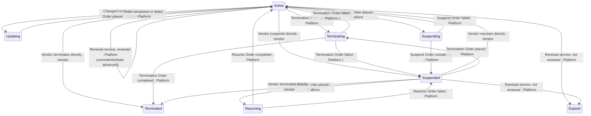

## State diagram

## States

<table>
  <thead>
    <tr>
      <th>State</th>
      <th>Description</th>
      <th>Initial State?</th>
      <th>Terminal State?</th>
    </tr>
  </thead>
  <tbody>
    <tr>
      <td>Active</td>
      <td>The Subscription is live and fulfilling. It is evaluated daily by the platform&#39;s renewal service and may be renewed, expired, suspended, updated, or terminated.</td>
      <td>Yes</td>
      <td>No</td>
    </tr>
    <tr>
      <td>Updating</td>
      <td>A Change or Configuration Order affecting this Subscription is being processed. The Subscription returns to Active when the Order completes or fails.</td>
      <td>No</td>
      <td>No</td>
    </tr>
    <tr>
      <td>Terminating</td>
      <td>A Termination Order affecting this Subscription is being processed. The Subscription transitions to Terminated when the Order completes, or reverts when it fails.</td>
      <td>No</td>
      <td>No</td>
    </tr>
    <tr>
      <td>Suspending</td>
      <td>A Suspend Order affecting this Subscription is being processed. The Subscription transitions to Suspended when the Order completes, or reverts to Active when it fails.</td>
      <td>No</td>
      <td>No</td>
    </tr>
    <tr>
      <td>Suspended</td>
      <td>Fulfilment is paused. The Subscription can be resumed, terminated, or expired.</td>
      <td>No</td>
      <td>No</td>
    </tr>
    <tr>
      <td>Resuming</td>
      <td>A Resume Order affecting this Subscription is being processed. The Subscription transitions to Active when the Order completes, or reverts to Suspended when it fails.</td>
      <td>No</td>
      <td>No</td>
    </tr>
    <tr>
      <td>Terminated</td>
      <td>The Subscription has been permanently ended — by a completed Termination Order or by direct Vendor action. Terminal — no outbound transitions.</td>
      <td>No</td>
      <td>Yes</td>
    </tr>
    <tr>
      <td>Expired</td>
      <td>The Subscription&#39;s `commitmentDate` passed without renewal and the platform&#39;s daily service moved it to Expired. Terminal — no outbound transitions.</td>
      <td>No</td>
      <td>Yes</td>
    </tr>
  </tbody>
</table>

## Transitions

<table>
  <thead>
    <tr>
      <th>ID</th>
      <th>From State</th>
      <th>To State</th>
      <th>Action</th>
      <th>Endpoint / Verb</th>
      <th>Actor</th>
      <th>Precondition</th>
      <th>Notes</th>
    </tr>
  </thead>
  <tbody>
    <tr>
      <td>T1</td>
      <td>—</td>
      <td>Active</td>
      <td>Order completed — promoted from the Order-scoped representation</td>
      <td>No dedicated endpoint — driven by Purchase/Change Order completion</td>
      <td>Platform</td>
      <td>Purchase or Change Order transitions to Completed</td>
      <td>Under Vendor token context. Same ID retained. Linked to the Agreement simultaneously.</td>
    </tr>
    <tr>
      <td>T2</td>
      <td>—</td>
      <td>Active</td>
      <td>Vendor creates directly</td>
      <td>`POST` (base collection endpoint)</td>
      <td>Vendor</td>
      <td>Parent Agreement is Active, New, or Draft</td>
      <td>Migration/vendor-sync. Created directly in Active without an Order.</td>
    </tr>
    <tr>
      <td>T3</td>
      <td>Active</td>
      <td>Updating</td>
      <td>Change or Configuration Order placed</td>
      <td>No dedicated endpoint — driven by Order state</td>
      <td>Platform</td>
      <td>Change or Configuration Order enters Processing</td>
      <td>Under the placing Actor&#39;s token context.</td>
    </tr>
    <tr>
      <td>T4</td>
      <td>Active</td>
      <td>Terminating</td>
      <td>Termination Order placed</td>
      <td>No dedicated endpoint — driven by Order state</td>
      <td>Platform</td>
      <td>Termination Order enters Processing</td>
      <td>Parent Agreement transitions to Updating.</td>
    </tr>
    <tr>
      <td>T5</td>
      <td>Active</td>
      <td>Terminated</td>
      <td>Vendor terminates directly</td>
      <td>`terminate`</td>
      <td>Vendor</td>
      <td>Parent Agreement is Active</td>
      <td>Immediate. `terminationDate` set to now, `autoRenew` forced false, active Lines set to quantity 0 and terminated. If last, Agreement → Terminated (BR-003).</td>
    </tr>
    <tr>
      <td>T6</td>
      <td>Active</td>
      <td>Suspended</td>
      <td>Vendor suspends directly</td>
      <td>`suspend`</td>
      <td>Vendor</td>
      <td>Parent Agreement is Active; the Product&#39;s Suspend/Resume setting permits Vendor suspend</td>
      <td>Immediate — skips Suspending.</td>
    </tr>
    <tr>
      <td>T7</td>
      <td>Active</td>
      <td>Suspending</td>
      <td>Suspend Order placed</td>
      <td>No dedicated endpoint — driven by Suspend Order state</td>
      <td>Platform</td>
      <td>Suspend Order (Operations) enters Processing; the Product&#39;s Suspend/Resume setting permits it</td>
      <td></td>
    </tr>
    <tr>
      <td>T8</td>
      <td>Active</td>
      <td>Expired</td>
      <td>Renewal service — not renewed</td>
      <td>No dedicated endpoint — daily renewal service</td>
      <td>Platform</td>
      <td>`commitmentDate` &lt; today, `autoRenew` = false, parent Agreement Active, and the Product&#39;s cessation setting permits expiry (BR-006)</td>
      <td>Terminal.</td>
    </tr>
    <tr>
      <td>T9</td>
      <td>Active</td>
      <td>Active</td>
      <td>Renewal service — renewed</td>
      <td>No dedicated endpoint — daily renewal service</td>
      <td>Platform</td>
      <td>`commitmentDate` &lt; today and `autoRenew` = true</td>
      <td>Not a state change. `commitmentDate` advanced by `terms.commitment`; `renewed` audit event recorded (BR-005).</td>
    </tr>
    <tr>
      <td>T10</td>
      <td>Updating</td>
      <td>Active</td>
      <td>Change or Configuration Order completed or failed</td>
      <td>No dedicated endpoint — driven by Order state</td>
      <td>Platform</td>
      <td>Order transitions to Completed or Failed</td>
      <td>Returns to Active in both cases.</td>
    </tr>
    <tr>
      <td>T11</td>
      <td>Terminating</td>
      <td>Terminated</td>
      <td>Termination Order completed</td>
      <td>No dedicated endpoint — driven by Order state</td>
      <td>Platform</td>
      <td>Termination Order transitions to Completed</td>
      <td>`terminationDate` set. If last, Agreement → Terminated (BR-003).</td>
    </tr>
    <tr>
      <td>T12</td>
      <td>Terminating</td>
      <td>Active</td>
      <td>Termination Order failed</td>
      <td>No dedicated endpoint — driven by Order state</td>
      <td>Platform</td>
      <td>Termination Order transitions to Failed</td>
      <td>Reverts unchanged (or to Suspended if the Subscription was Suspended before the Order).</td>
    </tr>
    <tr>
      <td>T13</td>
      <td>Suspending</td>
      <td>Suspended</td>
      <td>Suspend Order completed</td>
      <td>No dedicated endpoint — driven by Suspend Order state</td>
      <td>Platform</td>
      <td>Suspend Order transitions to Completed</td>
      <td></td>
    </tr>
    <tr>
      <td>T14</td>
      <td>Suspending</td>
      <td>Active</td>
      <td>Suspend Order failed</td>
      <td>No dedicated endpoint — driven by Suspend Order state</td>
      <td>Platform</td>
      <td>Suspend Order transitions to Failed</td>
      <td>Reverts unchanged.</td>
    </tr>
    <tr>
      <td>T15</td>
      <td>Suspended</td>
      <td>Active</td>
      <td>Vendor resumes directly</td>
      <td>`resume`</td>
      <td>Vendor</td>
      <td>Parent Agreement is Active; the Product&#39;s Suspend/Resume setting permits Vendor resume</td>
      <td>Immediate — skips Resuming. `resumed` audit event recorded.</td>
    </tr>
    <tr>
      <td>T16</td>
      <td>Suspended</td>
      <td>Resuming</td>
      <td>Resume Order placed</td>
      <td>No dedicated endpoint — driven by Resume Order state</td>
      <td>Platform</td>
      <td>Resume Order (Operations) enters Processing; the Product&#39;s Suspend/Resume setting permits it</td>
      <td></td>
    </tr>
    <tr>
      <td>T17</td>
      <td>Suspended</td>
      <td>Terminating</td>
      <td>Termination Order placed</td>
      <td>No dedicated endpoint — driven by Order state</td>
      <td>Platform</td>
      <td>Termination Order enters Processing</td>
      <td></td>
    </tr>
    <tr>
      <td>T18</td>
      <td>Suspended</td>
      <td>Terminated</td>
      <td>Vendor terminates directly</td>
      <td>`terminate`</td>
      <td>Vendor</td>
      <td>Parent Agreement is Active</td>
      <td>Immediate.</td>
    </tr>
    <tr>
      <td>T19</td>
      <td>Suspended</td>
      <td>Expired</td>
      <td>Renewal service — not renewed</td>
      <td>No dedicated endpoint — daily renewal service</td>
      <td>Platform</td>
      <td>`commitmentDate` &lt; today, parent Agreement Active, and the Product&#39;s cessation setting permits expiry</td>
      <td>Terminal. A Suspended Subscription past its commitment date is expired by the same daily service.</td>
    </tr>
    <tr>
      <td>T20</td>
      <td>Resuming</td>
      <td>Active</td>
      <td>Resume Order completed</td>
      <td>No dedicated endpoint — driven by Resume Order state</td>
      <td>Platform</td>
      <td>Resume Order transitions to Completed</td>
      <td></td>
    </tr>
    <tr>
      <td>T21</td>
      <td>Resuming</td>
      <td>Suspended</td>
      <td>Resume Order failed</td>
      <td>No dedicated endpoint — driven by Resume Order state</td>
      <td>Platform</td>
      <td>Resume Order transitions to Failed</td>
      <td>Reverts to Suspended.</td>
    </tr>
  </tbody>
</table>

