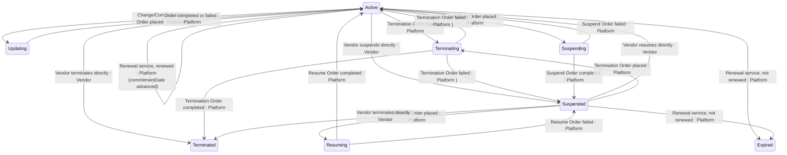

## Diagram

## States

<table>
  <thead>
    <tr>
      <th>State</th>
      <th>Description</th>
      <th>Initial State?</th>
      <th>Terminal State?</th>
    </tr>
  </thead>
  <tbody>
    <tr>
      <td>Active</td>
      <td>The Subscription is live and fulfilling. It is evaluated daily by the platform&#39;s renewal service and may be renewed, expired, suspended, updated, or terminated.</td>
      <td>Yes</td>
      <td>No</td>
    </tr>
    <tr>
      <td>Updating</td>
      <td>A Change or Configuration Order affecting this Subscription is being processed. The Subscription returns to Active when the Order completes or fails.</td>
      <td>No</td>
      <td>No</td>
    </tr>
    <tr>
      <td>Terminating</td>
      <td>A Termination Order affecting this Subscription is being processed. The Subscription transitions to Terminated when the Order completes, or reverts when it fails.</td>
      <td>No</td>
      <td>No</td>
    </tr>
    <tr>
      <td>Suspending</td>
      <td>A Suspend Order affecting this Subscription is being processed. The Subscription transitions to Suspended when the Order completes, or reverts to Active when it fails.</td>
      <td>No</td>
      <td>No</td>
    </tr>
    <tr>
      <td>Suspended</td>
      <td>Fulfilment is paused. The Subscription can be resumed, terminated, or expired.</td>
      <td>No</td>
      <td>No</td>
    </tr>
    <tr>
      <td>Resuming</td>
      <td>A Resume Order affecting this Subscription is being processed. The Subscription transitions to Active when the Order completes, or reverts to Suspended when it fails.</td>
      <td>No</td>
      <td>No</td>
    </tr>
    <tr>
      <td>Terminated</td>
      <td>The Subscription has been permanently ended — by a completed Termination Order or by direct Vendor action. Terminal — no outbound transitions.</td>
      <td>No</td>
      <td>Yes</td>
    </tr>
    <tr>
      <td>Expired</td>
      <td>The Subscription&#39;s `commitmentDate` passed without renewal and the platform&#39;s daily service moved it to Expired. Terminal — no outbound transitions.</td>
      <td>No</td>
      <td>Yes</td>
    </tr>
  </tbody>
</table>

## Transitions

<table>
  <thead>
    <tr>
      <th>ID</th>
      <th>To State</th>
      <th>Endpoint / Verb</th>
    </tr>
  </thead>
  <tbody>
    <tr>
      <td>T1</td>
      <td>Active</td>
      <td>No dedicated endpoint — driven by Purchase/Change Order completion</td>
    </tr>
    <tr>
      <td>T2</td>
      <td>Active</td>
      <td>`POST` (base collection endpoint)</td>
    </tr>
    <tr>
      <td>T3</td>
      <td>Updating</td>
      <td>No dedicated endpoint — driven by Order state</td>
    </tr>
    <tr>
      <td>T4</td>
      <td>Terminating</td>
      <td>No dedicated endpoint — driven by Order state</td>
    </tr>
    <tr>
      <td>T5</td>
      <td>Terminated</td>
      <td>`terminate`</td>
    </tr>
    <tr>
      <td>T6</td>
      <td>Suspended</td>
      <td>`suspend`</td>
    </tr>
    <tr>
      <td>T7</td>
      <td>Suspending</td>
      <td>No dedicated endpoint — driven by Suspend Order state</td>
    </tr>
    <tr>
      <td>T8</td>
      <td>Expired</td>
      <td>No dedicated endpoint — daily renewal service</td>
    </tr>
    <tr>
      <td>T9</td>
      <td>Active</td>
      <td>No dedicated endpoint — daily renewal service</td>
    </tr>
    <tr>
      <td>T10</td>
      <td>Active</td>
      <td>No dedicated endpoint — driven by Order state</td>
    </tr>
    <tr>
      <td>T11</td>
      <td>Terminated</td>
      <td>No dedicated endpoint — driven by Order state</td>
    </tr>
    <tr>
      <td>T12</td>
      <td>Active</td>
      <td>No dedicated endpoint — driven by Order state</td>
    </tr>
    <tr>
      <td>T13</td>
      <td>Suspended</td>
      <td>No dedicated endpoint — driven by Suspend Order state</td>
    </tr>
    <tr>
      <td>T14</td>
      <td>Active</td>
      <td>No dedicated endpoint — driven by Suspend Order state</td>
    </tr>
    <tr>
      <td>T15</td>
      <td>Active</td>
      <td>`resume`</td>
    </tr>
    <tr>
      <td>T16</td>
      <td>Resuming</td>
      <td>No dedicated endpoint — driven by Resume Order state</td>
    </tr>
    <tr>
      <td>T17</td>
      <td>Terminating</td>
      <td>No dedicated endpoint — driven by Order state</td>
    </tr>
    <tr>
      <td>T18</td>
      <td>Terminated</td>
      <td>`terminate`</td>
    </tr>
    <tr>
      <td>T19</td>
      <td>Expired</td>
      <td>No dedicated endpoint — daily renewal service</td>
    </tr>
    <tr>
      <td>T20</td>
      <td>Active</td>
      <td>No dedicated endpoint — driven by Resume Order state</td>
    </tr>
    <tr>
      <td>T21</td>
      <td>Suspended</td>
      <td>No dedicated endpoint — driven by Resume Order state</td>
    </tr>
  </tbody>
</table>

