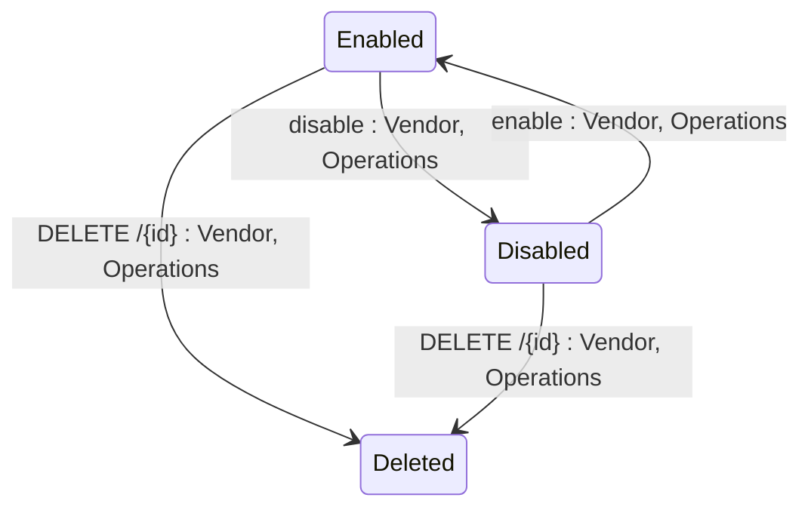

## Diagram

## States

<table>
  <thead>
    <tr>
      <th>State</th>
      <th>Description</th>
      <th>Initial State?</th>
      <th>Terminal State?</th>
    </tr>
  </thead>
  <tbody>
    <tr>
      <td>Enabled</td>
      <td>Webhook is active. The platform will call the configured endpoint when matching events occur.</td>
      <td>Yes</td>
      <td>No</td>
    </tr>
    <tr>
      <td>Disabled</td>
      <td>Webhook is inactive. The platform will not call the endpoint. Events are not queued.</td>
      <td>No</td>
      <td>No</td>
    </tr>
    <tr>
      <td>Deleted</td>
      <td>Webhook has been soft-deleted. No longer visible via the API in any context.</td>
      <td>No</td>
      <td>Yes</td>
    </tr>
  </tbody>
</table>

## Transitions

<table>
  <thead>
    <tr>
      <th>From State</th>
      <th>To State</th>
      <th>Action</th>
      <th>Endpoint / Verb</th>
      <th>Actor</th>
    </tr>
  </thead>
  <tbody>
    <tr>
      <td>—</td>
      <td>Enabled</td>
      <td>Create Webhook</td>
      <td>`POST` (base collection endpoint)</td>
      <td>Vendor, Operations</td>
    </tr>
    <tr>
      <td>Enabled</td>
      <td>Disabled</td>
      <td>Disable Webhook</td>
      <td>`disable` (`POST .../{id}/disable`)</td>
      <td>Vendor, Operations</td>
    </tr>
    <tr>
      <td>Disabled</td>
      <td>Enabled</td>
      <td>Enable Webhook</td>
      <td>`enable` (`POST .../{id}/enable`)</td>
      <td>Vendor, Operations</td>
    </tr>
    <tr>
      <td>Enabled</td>
      <td>Deleted</td>
      <td>Delete Webhook</td>
      <td>`DELETE /{id}`</td>
      <td>Vendor, Operations</td>
    </tr>
    <tr>
      <td>Disabled</td>
      <td>Deleted</td>
      <td>Delete Webhook</td>
      <td>`DELETE /{id}`</td>
      <td>Vendor, Operations</td>
    </tr>
  </tbody>
</table>

