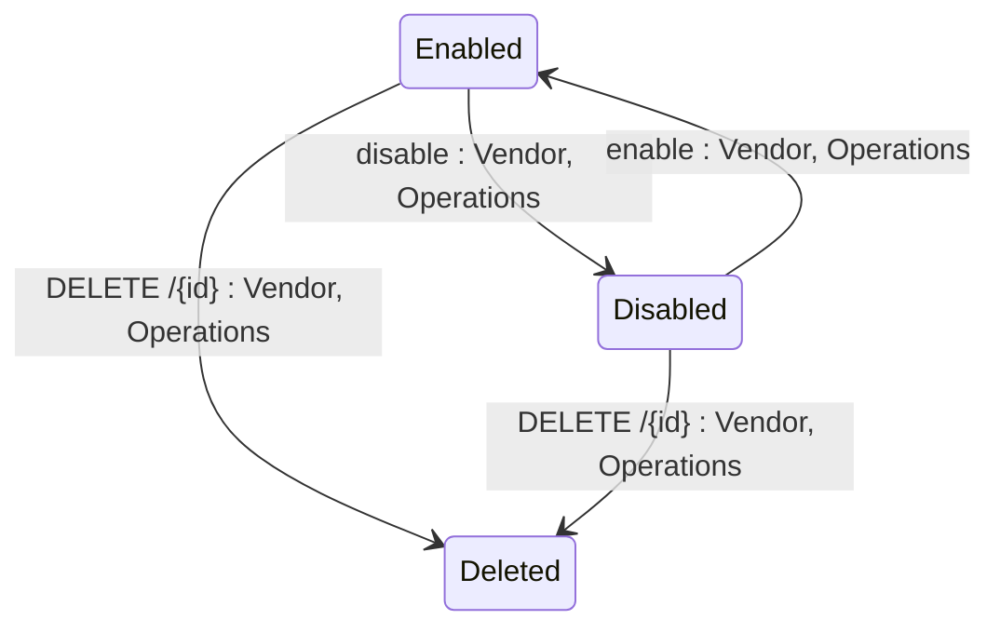

## State diagram

| State | Description | Initial State? | Terminal State? |
| --- | --- | --- | --- |

| Enabled | Webhook is active. The platform will call the configured endpoint when matching events occur. | Yes | No |

| Disabled | Webhook is inactive. The platform will not call the endpoint. Events are not queued. | No | No |

| Deleted | Webhook has been soft-deleted. No longer visible via the API in any context. | No | Yes |

